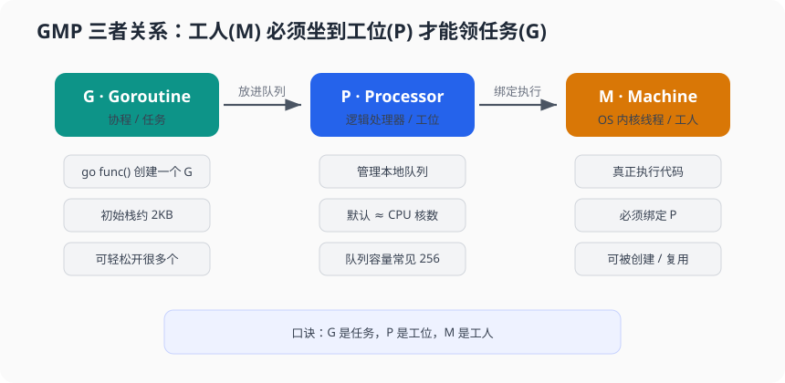
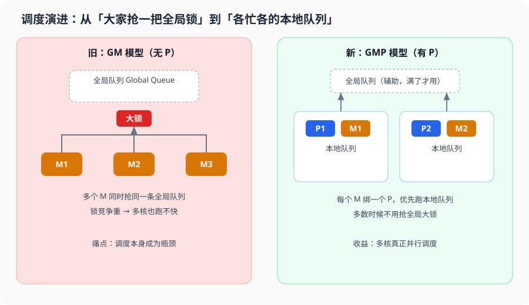
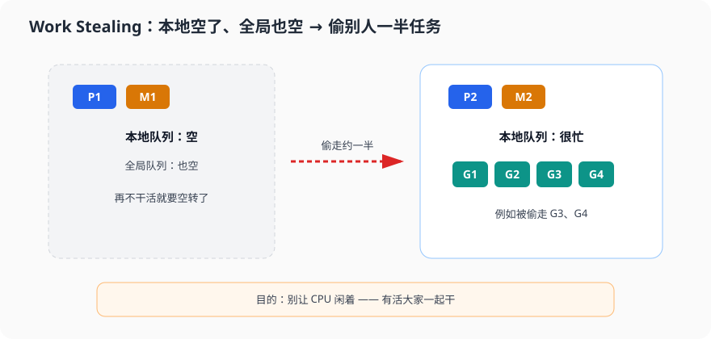
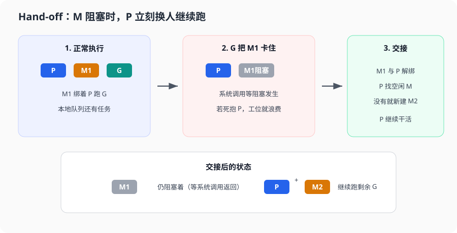
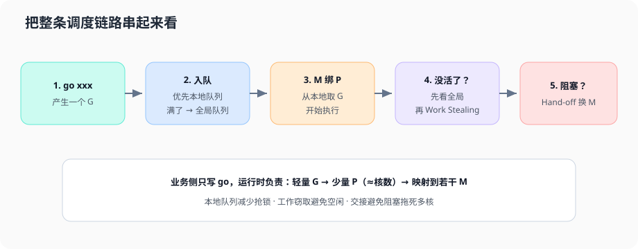

# 1. go基础语法

## 1. Go 语言基础入门

### 1.1 Go 语言特点

Go 的设计哲学是「少即是多」—— 砍掉冗余特性，专注工程效率与可维护性。以下是它最核心的几大特点：

- **原生并发**：基于 goroutine 与 channel 实现 CSP 并发模型，协程初始栈仅数 KB，远比传统 OS 线程轻量，由运行时统一调度，天然适合高并发服务
- **自动内存管理**：内置 GC 垃圾回收器，无需像 C/C++ 那样手动申请与释放内存，在开发效率与运行安全之间取得平衡
- **静态编译**：编译产物为单一可执行文件，无外部运行时依赖，拷贝到目标机器即可运行，部署极其简单
- **跨平台编译**：内置交叉编译能力，在 macOS 上一条 `go build` 命令即可产出 Linux、Windows 等平台的二进制文件
- **语法简洁**：仅 25 个关键字，用组合替代继承，拒绝过度设计，代码易读易写，学习曲线平缓
- **编译速度极快**：大型项目完整编译通常在秒级完成，修改代码后几乎即编即跑，开发体验流畅
- **标准库强大**：`net/http`、`encoding/json`、`context` 等核心库久经生产验证，网络、序列化、并发控制等常见需求开箱即用
- **工具链一体化**：`go mod` 管理依赖、`go test` 运行测试、`go fmt` 统一格式，从编码到发布全流程有官方工具支撑

### 1.2 如何安装 Go 语言

1. **下载安装包**：在 Go 语言官网（https://go.dev/dl/）选择你所对应的操作系统，点击下载安装包。
2. **安装**：一路下一步，直到安装完成。
3. **验证安装**：在终端输入 `go version` 命令，如果显示 Go 语言的版本信息，则说明安装成功（目前主包用的是 `1.26.4` 版本）。
4. **编辑器下载**：推荐使用 VS Code 编辑器，因为 Go 语言官方推荐使用 VS Code 作为开发工具。
5. **配置 Go 语言插件**：在 VS Code 中安装 Go 语言插件，安装完成后，VS Code 会自动配置 Go 语言环境。

### 1.3 为什么要学 Go

- **就业市场需求大**：字节、腾讯、美团、百度等大厂的后端、基础架构、中间件岗位大量招聘 Go 开发；云原生、微服务方向几乎绕不开它
- **薪资有竞争力**：具备 Go + 云原生（K8s、Docker）技能的工程师，在市场上通常比纯 CRUD 后端更有议价空间
- **入门门槛相对友好**：语法简洁、关键字少，有 Python、Java 或前端 JS 基础的同学，通常一两周就能写出可运行的服务
- **前端转全栈的务实选择**：纯前端岗位竞争加剧，掌握 Go 后可以独立完成后端 API、中间层逻辑，向全栈或平台工程方向发展
- **云原生时代的「官方语言」**：Docker、Kubernetes、Prometheus、Etcd 等核心基础设施均用 Go 编写，学 Go 有助于真正理解这些工具的底层原理
- **区块链 / Web3 的主流技术栈**：以太坊 Go 客户端 Geth、Hyperledger Fabric 等均基于 Go，相关岗位普遍将其列为硬性要求
- **适用场景广**：微服务 API、命令行工具、爬虫、消息队列、网关、DevOps 脚本——从业务到基建都能覆盖
- **性能与开发效率的平衡**：编译快、部署简单、并发模型清晰，在需要高并发但又不想陷入 C++ 复杂度的场景里，Go 是性价比很高的选择

## 2. 第一个 Go 程序

### 2.1 Hello World

新建一个 `hello.go` 文件，然后输入以下代码：

```go
package main
import "fmt"
func main() {
	fmt.Println("Hello, World!")
}
```

然后打开终端，输入 `go run hello.go` 命令，运行程序：

```
go run hello.go
```

输出：`Hello, World!`

### 2.2 package main

```go
package main
```

- `package main` = 告诉 Go 编译器，这是程序的入口包（可执行程序）。
- Go 官方规定，程序入口必须叫 `main`，名字是固定的，不能修改。

例如我改成 `aaa` 会报错：

```go
package aaa

import "fmt"

func main() {
	fmt.Println("Hello, World!")
}
```

错误提示：

```
package command-line-arguments is not a main package
```

### 2.3 import "fmt"

导入（Import）Go 标准库中的 `fmt` 包，让当前文件可以使用它提供的功能。

- `fmt`：Go 官方提供的格式化输入输出包。
- `Println()`：`fmt` 包中的一个函数，用来打印内容并换行。

### 2.4 func main()

- `func main()`：定义一个名为 `main` 的函数，这是 Go 程序的入口函数。
- `{}`：`main` 函数的代码块，必须有。
- `fmt.Println("Hello, World!")`：调用 `fmt` 包中的 `Println` 函数，打印 "Hello, World!" 字符串。

## 3. 变量声明

Go 变量标准完整声明格式：`var 变量名 数据类型 = 初始值`

```go
package main

import "fmt"

func main() {
	//关键字 变量名 类型 = 值
	var name string = "zuishuaicc"
	fmt.Println(name)
}
```

以上便是变量声明的规则，我们声明了一个字符串类型的变量 `name`，并赋值为 "zuishuaicc"。什么时候该用字符串呢？你在网页中所看到的大部分文本和文字都是字符串，比如："你好，世界！"、"Hello, World!"、"こんにちは、世界！"等。所以，当你需要存储文本、文字或任何字符序列时，就可以使用字符串类型。

### 3.1 类型推断

类型推断是 Go 语言的一种特性，它可以根据变量的值自动推断变量的类型。比如：

```go
package main

import "fmt"

func main() {
	//关键字 变量名 类型 = 值
	var name = "zuishuaicc"
	var age = 18 //int 表示整数类型
	fmt.Println(name, age) //输出：zuishuaicc 18
}
```

当你鼠标悬浮在变量名上时，会自动显示变量的类型和值。如上所示，`name` 的类型为 `string`，`age` 的类型为 `int`。

### 3.2 自动零值

```go
package main

import "fmt"

func main() {
	var name string
	var age int
	fmt.Println(name, age) //输出："" 0
}
```

我们可以声明变量不赋值，那么变量就会有一个默认值。输出结果为：`"" 0`，因为 `name` 和 `age` 没有赋值，所以默认值为空字符串和 0。

### 3.3 变量简写

```go
package main

import "fmt"

func main() {
	//变量名 := 值
	name := "zuishuaicc"
	fmt.Println(name)
}
```

我们可以用 `:=` 来简写变量声明，可以省略类型和关键字，但是不能省略变量名和值。

注意点：变量简写只能用于函数内部，不能用于全局变量。

### 3.4 多变量声明

```go
package main

import "fmt"

func main() {
	//多个变量用逗号隔开
	age, name := 18, "zuishuaicc"
	fmt.Println(age, name) //输出：18 zuishuaicc
}
```

多个变量声明需要用 `,` 隔开，并且赋值的时候也是根据顺序赋值。例如 `age = 18`，`name = "zuishuaicc"`。

## 4. Go 数据类型

Go 语言中数字类型有多种，包括整数、浮点数、复数等，再加上字符串、布尔等，构成了 Go 的基础数据类型体系。

### 4.1 字符串

Go 语言中字符串需要通过双引号包裹文本内容，如果有多段文本需要拼接，可以使用加号 `+` 进行拼接。如果需要换行，可以使用反斜杠 `\n` 进行换行。

```go
package main

import "fmt"

func main() {
	text := "这是一段文本，苍天已死，黄天当立，岁在甲子，天下大吉。"
	text += "\n这是第二段文本，天地玄黄，宇宙洪荒，日月盈昃，辰宿列张。"
	fmt.Println(text)
}
```

输出内容如下：

```
这是一段文本，苍天已死，黄天当立，岁在甲子，天下大吉。
这是第二段文本，天地玄黄，宇宙洪荒，日月盈昃，辰宿列张。
```

### 4.2 数字

整数包括有符号和无符号两种，有符号包括 `int8`、`int16`、`int32`、`int64`，无符号包括 `uint8`、`uint16`、`uint32`、`uint64`。

有符号和无符号的区别是：有符号可以表示正数和负数，无符号只能表示正数。

```go
package main

import "fmt"

func main() {
	var age int = 18
	fmt.Println(age)
}
```

| 类型 | 占用字节数 | 取值范围 |
| --- | --- | --- |
| int8 | 1 字节 | -128 ~ 127 |
| int16 | 2 字节 | -32768 ~ 32767 |
| int32 | 4 字节 | -2147483648 ~ 2147483647 |
| int64 | 8 字节 | -9223372036854775808 ~ 9223372036854775807 |
| int | 自适应 | 32 位系统同 int32，64 位系统同 int64 |

| 类型 | 占用字节数 | 取值范围 |
| --- | --- | --- |
| uint8 | 1 字节 | 0 ~ 255 |
| uint16 | 2 字节 | 0 ~ 65535 |
| uint32 | 4 字节 | 0 ~ 4294967295 |
| uint64 | 8 字节 | 0 ~ 18446744073709551615 |
| uint | 自适应 | 32 位系统同 uint32，64 位系统同 uint64 |
| uintptr | 自适应 | 与 uint 范围一致，用于存储内存地址 |

浮点数包括单精度浮点数和双精度浮点数，分别对应 `float32` 和 `float64`。

| 类型 | 名称 | 字节 | 有效精度 |
| --- | --- | --- | --- |
| float32 | 单精度 | 4 | 5~7 位 |
| float64 | 双精度 | 8 | 15~16 位 |

### 4.3 布尔

布尔值只有两个：`true` 和 `false`。一般用于条件判断和状态表示，例如开关：如果开启则是 `true`，如果关闭则是 `false`。

```go
package main

import "fmt"

func main() {
	var isShow bool = true
	fmt.Println(isShow)
}
```

### 4.4 数组 和 切片

```go
package main

import "fmt"

func main() {
	// 数组：定义一个长度为 5 的整型数组，但未赋值，所以输出为 [0 0 0 0 0]
	var arr [5]int
	fmt.Println(arr)

	arr2 := [5]int{1, 2, 3, 4, 5} // 定义一个长度为 5 的整型数组并赋值为 [1 2 3 4 5]
	fmt.Println(arr2)

	// 切片
	arr3 := []int{}                          // 定义一个空切片
	arr3 = append(arr3, 6, 6, 6, 6, 6, 6, 6) // 追加元素
	fmt.Println(arr3)                        // 输出为 [6 6 6 6 6 6 6]
	fmt.Println(len(arr3))                   // 获取切片的长度，输出为 7
}
```

**数组**是长度固定的连续内存块，定义后长度不可变，未赋值的元素会使用对应类型的零值（整型为 `0`）。

**切片**是对数组的抽象，长度可变，底层仍依赖数组。常用 `append` 追加元素，用 `len` 获取当前长度，用 `cap` 获取底层数组容量。

| 特性 | 数组 | 切片 |
| --- | --- | --- |
| 长度 | 固定，定义时确定 | 可变 |
| 声明 | `[5]int` | `[]int` |
| 传参 | 值传递，会复制整个数组 | 引用传递，共享底层数据 |
| 适用场景 | 固定大小、性能敏感 | 日常开发中最常用 |

### 4.5 映射

映射（`map`）是一种键值对集合，通过键快速查找对应的值。键的类型必须是可比较类型（如 `string`、`int`），值可以是任意类型。

```go
package main

import "fmt"

func main() {
	// 定义一个 map，键为 string，值为 int
	scores := map[string]int{
		"张三": 90,
		"李四": 85,
		"王五": 92,
	}
	fmt.Println(scores["张三"]) // 输出：90

	// 添加或修改键值对
	scores["赵六"] = 88
	delete(scores, "李四") // 删除键值对

	// 判断键是否存在
	score, ok := scores["张三"]
	if ok {
		fmt.Println("张三的分数是", score)
	}
}
```

常用操作：

- `map[key]` — 读取值，键不存在时返回零值
- `map[key] = value` — 添加或修改
- `delete(map, key)` — 删除键值对
- `value, ok := map[key]` — 判断键是否存在，`ok` 为 `true` 表示存在

### 4.6 结构体

结构体（`struct`）用于将多个不同类型的字段组合成一个自定义类型，是面向对象编程的基础。通过 `type 名称 struct { ... }` 定义，用点号 `.` 访问字段。

结构体适合描述具有多个属性的实体，例如用户信息、商品详情、坐标点等。

```go
package main

import "fmt"

// 定义结构体类型
type Person struct {
	Name string
	Age  int
}

func main() {
	// 创建结构体实例
	p := Person{
		Name: "zuishuaicc",
		Age:  18,
	}
	fmt.Println(p.Name, p.Age) // 输出：zuishuaicc 18

	// 访问和修改字段
	p.Age = 20
	fmt.Println(p.Age) // 输出：20
}
```

### 4.7 接口

接口（`interface`）定义了一组方法签名，任何实现了这些方法的类型都自动满足该接口，无需显式声明。这是 Go 实现多态的核心机制。

接口的特点：

- **隐式实现**：只要类型实现了接口的所有方法，就满足该接口
- **空接口** `interface{}`（或 `any`）可以接收任意类型的值
- **组合接口**：多个接口可以嵌入组合成更大的接口

接口让代码更灵活——函数可以接收接口类型参数，从而兼容所有实现了该接口的类型，便于扩展和测试。

```go
package main

import "fmt"

// 定义接口：包含一个 Speak 方法
type Animal interface {
	Speak() string
}

type Dog struct{}
type Cat struct{}

func (d Dog) Speak() string { return "汪汪" }
func (c Cat) Speak() string { return "喵喵" }

func main() {
	var a Animal

	a = Dog{}
	fmt.Println(a.Speak()) // 输出：汪汪

	a = Cat{}
	fmt.Println(a.Speak()) // 输出：喵喵
}
```

## 5. Go 类型转换

实际开发里，不同类型之间经常需要互相转换：字符串转数字、数字转字符串、浮点数转整数、整数转浮点数，等等。

### 5.1 数字的转换

比如有一个浮点数 `3.1415926535`，想把它变成整数，可以用 `int()` 来转换：

```go
package main
import "fmt"

func main() {
	num := 3.1415926535
	intNum := int(num)
	fmt.Println(intNum) // 3
}
```

可以看到，`int()` 会把浮点数转成整数，并直接舍去小数部分（不是四舍五入）。

其他数值类型的转换写法也类似，记起来很简单——跟定义类型时的名字一模一样：

- `int()`：转为 `int`
- `int8()`：转为 `int8`
- `int16()`：转为 `int16`
- `int32()`：转为 `int32`
- `int64()`：转为 `int64`
- `uint()`：转为 `uint`
- `uint8()`：转为 `uint8`
- `uint16()`：转为 `uint16`
- `uint32()`：转为 `uint32`
- `uint64()`：转为 `uint64`
- `float32()`：转为 `float32`
- `float64()`：转为 `float64`

### 5.2 数字转字符串

数字和字符串之间的转换要用 `strconv`（string convert，字符串转换）包。比如把整数 `3` 转成字符串：

```go
package main

import (
	"fmt"
	"strconv"
)

func main() {
	num := 3
	strNum := strconv.Itoa(num)
	fmt.Printf("类型: %T,值: %v", strNum, strNum)
	// 类型: string,值: 3
}
```

几点说明：

- 导入多个包时，用 `()` 分组，每个包独占一行。
- `strconv.Itoa()` 就是 **Int to ASCII**：把整数转成字符串（字符串本质上是字符序列）。
- `fmt.Printf()` 里，`%T` 打印类型，`%v` 打印值。

### 5.3 字符串转数字

反过来，字符串转数字也很常见。Go 里字符串和数字不能直接运算，必须先转成同一类型。比如这样会报错：

```go
var a = "10"
var b = 20
var c = a + b // 错误：字符串和数字不能直接运算
```

这时可以用 `strconv.Atoi()` 把字符串转成整数：

```go
package main

import (
	"fmt"
	"strconv"
)

func main() {
	str := "10"
	num, _ := strconv.Atoi(str)
	fmt.Printf("类型: %T,值: %v", num, num)
	// 类型: int,值: 10
}
```

`Atoi` 是 **ASCII to Int** 的缩写。它会返回两个值：转换结果和错误。转换失败时第二个返回值不为 `nil`；这里用 `_` 忽略错误，表示暂时不处理失败情况。

### 5.4 字符串转布尔值

字符串转布尔用 `strconv.ParseBool()`。它同样返回「结果 + 错误」两个值：

```go
package main

import (
	"fmt"
	"strconv"
)

func main() {
	str := "true"
	b, _ := strconv.ParseBool(str)
	fmt.Printf("类型: %T,值: %v", b, b)
	// 类型: bool,值: true
}
```

`ParseBool` 能识别的真值有：`1`、`t`、`T`、`TRUE`、`true`、`True`；假值有：`0`、`f`、`F`、`FALSE`、`false`、`False`。其他字符串都会转换失败。

### 5.5 布尔值转字符串

反过来，用 `strconv.FormatBool()` 把布尔值转成字符串，结果只会是 `"true"` 或 `"false"`：

```go
package main

import (
	"fmt"
	"strconv"
)

func main() {
	flag := true
	str := strconv.FormatBool(flag)
	fmt.Printf("类型: %T,值: %v", str, str)
	// 类型: string,值: true
}
```

## 6. Go 数组和切片

数组和切片都是用来存放一组同类型数据的结构，写法也很像，所以放在一起讲。先记住一个关键区别：**数组长度固定，切片长度可变**。

### 6.1 数组

数组的长度在声明时就定死了，之后不能改。元素类型随意，但同一数组里必须是同一种类型。

语法：

```
var 数组名 = [长度]类型{值1, 值2, 值3, ...}
数组名 := [长度]类型{值1, 值2, 值3, ...}
```

例子：

```go
package main

import "fmt"

func main() {
	var arr = [5]int{1, 2, 3, 4, 5}
	arr2 := [5]int{6, 7, 8, 9, 10}
	fmt.Println(arr, arr2)
}
```

两种写法都能声明数组：`var` 完整声明，或 `:=` 短声明。`[5]int` 表示「长度为 5、元素类型为 `int`」——**长度是类型的一部分**，`[5]int` 和 `[4]int` 是两种不同类型。

#### 6.1.1 读写元素

通过下标访问和修改元素。下标从 `0` 开始：

```go
package main

import "fmt"

func main() {
	arr := [4]string{"唱", "跳", "rap", "篮球"}
	// 下标：  0    1     2      3

	fmt.Println(arr[0]) // 唱

	arr[0] = "篮球"
	fmt.Println(arr[0]) // 篮球
}
```

#### 6.1.2 获取长度

用内置函数 `len` 获取数组长度：

```go
package main

import "fmt"

func main() {
	arr := [4]string{"唱", "跳", "rap", "篮球"}
	fmt.Println(len(arr)) // 4
}
```

### 6.2 切片

切片可以看作「可变长度的数组」。日常开发里用得比数组多得多。

语法上，把数组的长度去掉就行：

```
var 切片名 = []类型{值1, 值2, 值3, ...}
切片名 := []类型{值1, 值2, 值3, ...}
```

例子：

```go
package main

import "fmt"

func main() {
	var s1 = []int{1, 2, 3}
	s2 := []string{"唱", "跳", "rap"}
	fmt.Println(s1, s2)
}
```

`[]int` 没有写死长度，所以这是切片，不是数组。

#### 6.2.1 读写元素

读写方式和数组一样，也是按下标操作：

```go
package main

import "fmt"

func main() {
	s := []string{"唱", "跳", "rap", "篮球"}

	fmt.Println(s[1]) // 跳

	s[1] = "打球"
	fmt.Println(s) // [唱 打球 rap 篮球]
}
```

#### 6.2.2 长度与容量

切片有两个常用属性：

- `len`：当前元素个数
- `cap`：底层数组的容量（还能装多少，不用立刻扩容）

```go
package main

import "fmt"

func main() {
	s := []int{1, 2, 3}
	fmt.Println(len(s)) // 3
	fmt.Println(cap(s)) // 3
}
```

#### 6.2.3 切片截取

用 `切片[低:高]` 可以从已有切片（或数组）上「切」出一段，得到一个新切片。区间是**左闭右开**：包含下标 `低`，不包含下标 `高`。

```go
package main

import "fmt"

func main() {
	s := []int{10, 20, 30, 40, 50}
	// 下标：  0   1   2   3   4

	fmt.Println(s[1:4]) // [20 30 40]  取下标 1、2、3
	fmt.Println(s[:3])  // [10 20 30]  从头切到下标 3（不含 3）
	fmt.Println(s[2:])  // [30 40 50]  从下标 2 切到末尾
	fmt.Println(s[:])   // [10 20 30 40 50]  整段复制一份切片头
}
```

几种常见写法：

| 写法 | 含义 |
| --- | --- |
| `s[低:高]` | 从 `低` 到 `高`（不含 `高`） |
| `s[:高]` | 从开头到 `高`（不含 `高`） |
| `s[低:]` | 从 `低` 到末尾 |
| `s[:]` | 整段截取 |

也可以对数组做同样的事，结果是一个切片：

```go
package main

import "fmt"

func main() {
	arr := [5]int{10, 20, 30, 40, 50}
	s := arr[1:4]
	fmt.Println(s) // [20 30 40]
}
```

截取出来的切片和原数据共享底层数组：改一边，另一边也会变。后面做前置追加、中间插入时，会经常用到 `s[:idx]`、`s[idx:]` 这种写法。

#### 6.2.4 追加元素

切片长度可变，最常见的操作就是往里面加元素。Go 只内置了往**尾部**追加的 `append`；往前面插、往中间插，都要靠 `append` 和切片截取自己拼。

**尾部追加**

`append` 接收原切片和要追加的元素，返回一个新切片。容量不够时会自动扩容：

```go
package main

import "fmt"

func main() {
	s := []int{1, 2, 3}
	s = append(s, 4, 5)
	fmt.Println(s) // [1 2 3 4 5]
}
```

一次可以追加多个值。记得把返回值接回来（`s = append(...)`），否则原切片看不到新增内容。

**前置追加**

Go 没有「往头部插入」的内置函数，思路是：先建一个装着新元素的切片，再用 `append` 把原切片接在后面。

这里会用到 `...`（展开操作符）：`s...` 表示把切片 `s` 里的元素一个个拆开，当作多个参数传给 `append`。

```go
package main

import "fmt"

func main() {
	s := []int{1, 2, 3, 4, 5}
	s = append([]int{-1, 0}, s...)
	// 等同于：append([]int{-1, 0}, 1, 2, 3, 4, 5)
	fmt.Println(s) // [-1 0 1 2 3 4 5]
}
```

拆开看就两步：

- `[]int{-1, 0}`：要插到前面的新元素
- `s...`：把原来的 `1, 2, 3, 4, 5` 展开，接到后面

**中间插入**

中间插入同样没有内置方法，本质是把切片拆成「前半段 + 新元素 + 后半段」，再拼回去。

假设切片是 `[-1 0 1 2 3 4 5]`，想在 `2` 后面（下标 `4` 的位置）插入 `100, 200`：

```go
package main

import "fmt"

func main() {
	s := []int{-1, 0, 1, 2, 3, 4, 5}
	// 下标：  0  1  2  3  4  5  6
	idx := 4 // 从下标 4 开始插入，也就是 2 的后面

	s = append(s[:idx], append([]int{100, 200}, s[idx:]...)...)
	fmt.Println(s) // [-1 0 1 2 100 200 3 4 5]
}
```

这行可以拆成三块理解：

| 部分 | 含义 | 结果 |
| --- | --- | --- |
| `s[:idx]` | 插入点之前 | `[-1 0 1 2]` |
| `[]int{100, 200}` | 要插入的内容 | `[100 200]` |
| `s[idx:]` | 插入点及之后 | `[3 4 5]` |

先用 `append([]int{100, 200}, s[idx:]...)` 得到 `[100 200 3 4 5]`，再接到 `s[:idx]` 后面，就拼成了最终结果。

写法有点绕，但记口诀就行：**前半段 + 新元素 + 后半段**。

### 6.3 数组 vs 切片

|  | 数组 | 切片 |
| --- | --- | --- |
| 长度 | 固定，声明时确定 | 可变，可用 `append` 增减 |
| 类型写法 | `[5]int` | `[]int` |
| 传递方式 | 值拷贝（复制整个数组） | 引用底层数组（更轻量） |
| 使用场景 | 长度已知且不变 | 日常开发更常用 |

入门阶段可以先记住：**不确定长度、或需要增删，就用切片。**

## 7. Go 结构体

结构体是 Go 中的一种复合数据类型，用于将多个不同类型的数据组合在一起，形成一个新的数据类型。日常开发里，用结构体描述「一个人」「一辆车」「一条订单」这类对象非常常见。

### 7.1 定义结构体

用 `type` + `struct` 定义一种新类型：

```
type 结构体名 struct {
	字段名 类型
	字段名 类型
	字段名 类型
}
```

实操：定义一个 `Person`，包含姓名、年龄和爱好：

```go
package main

import "fmt"

type Person struct {
	Name  string
	Age   int
	Hobby []string
}

func main() {
	person := Person{
		Name:  "John",
		Age:   20,
		Hobby: []string{"reading", "swimming"},
	}
	fmt.Println(person)
}
```

`Person{...}` 是字面量初始化：按字段名赋值，顺序可以随便写，没写的字段会是该类型的零值。

#### 7.1.1 字段读写

通过 `.` 访问和修改字段：

```go
package main

import "fmt"

type Person struct {
	Name string
	Age  int
}

func main() {
	p := Person{Name: "张三", Age: 18}
	fmt.Println(p.Name) // 张三

	p.Age = 20
	fmt.Println(p.Age) // 20
}
```

#### 7.1.2 几种初始化方式

```go
package main

import "fmt"

type Person struct {
	Name string
	Age  int
}

func main() {
	// 1. 按字段名初始化（推荐，可读性好）
	p1 := Person{Name: "张三", Age: 18}

	// 2. 按字段顺序初始化（字段多时容易写错，不推荐）
	p2 := Person{"李四", 20}

	// 3. 只给部分字段赋值，其余为零值
	p3 := Person{Name: "王五"} // Age 为 0

	// 4. 先声明再赋值（全部为零值）
	var p4 Person
	p4.Name = "赵六"
	p4.Age = 22

	// 5. 取地址，得到 *Person
	p5 := &Person{Name: "钱七", Age: 25}

	fmt.Println(p1, p2, p3, p4, p5)
}
```

指针形式 `p5` 访问字段时，Go 会自动解引用，写 `p5.Name` 即可，不必写 `(*p5).Name`。

### 7.2 结构体嵌套

一个结构体里可以包含另一个结构体类型的字段，用来组合更复杂的数据：

```go
package main

import "fmt"

type Car struct {
	Brand string
	Model string
	Year  int
}

type Person struct {
	Name  string
	Age   int
	Hobby []string
	Car   Car
}

func main() {
	person := Person{
		Name:  "John",
		Age:   20,
		Hobby: []string{"reading", "swimming"},
		Car: Car{
			Brand: "Toyota",
			Model: "Camry",
			Year:  2020,
		},
	}
	fmt.Println(person)
	fmt.Println(person.Car.Brand) // Toyota
}
```

这里 `Car` 是命名字段，访问时要写 `person.Car.Brand`。

### 7.3 结构体嵌入

如果字段类型前**不写字段名**，就是嵌入（匿名字段）。嵌入后，被嵌入类型的字段和方法会「提升」到外层，可以直接用：

```go
package main

import "fmt"

type Car struct {
	Brand string
	Model string
	Year  int
}

type Person struct {
	Name string
	Age  int
	Car        // 嵌入：没有字段名，只有类型
}

func main() {
	person := Person{
		Name: "John",
		Age:  20,
		Car: Car{
			Brand: "Toyota",
			Model: "Camry",
			Year:  2020,
		},
	}

	// 提升后可以直接访问
	fmt.Println(person.Brand) // Toyota
	// 也可以走完整路径
	fmt.Println(person.Car.Model) // Camry
}
```

嵌套是「有名字的组合」；嵌入是「把另一个类型的能力提升过来」。两者都能组合数据，嵌入更适合表达「is-a / 带有某种能力」的关系。

### 7.4 方法

方法是「绑在某个类型上的函数」。接收者写在 `func` 和函数名之间：

```
func (接收者 类型) 方法名(参数列表) 返回值 {
	// ...
}
```

#### 7.4.1 值接收者

```go
package main

import "fmt"

type Person struct {
	Name string
	Age  int
}

func (p Person) Introduce() {
	fmt.Printf("我叫 %s，今年 %d 岁\n", p.Name, p.Age)
}

func main() {
	p := Person{Name: "张三", Age: 18}
	p.Introduce() // 我叫 张三，今年 18 岁
}
```

值接收者拿到的是副本，方法里改字段**不会**影响原变量。

#### 7.4.2 指针接收者

需要修改结构体本身时，用指针接收者：

```go
package main

import "fmt"

type Person struct {
	Name string
	Age  int
}

func (p *Person) GrowUp() {
	p.Age++
}

func (p Person) Introduce() {
	fmt.Printf("我叫 %s，今年 %d 岁\n", p.Name, p.Age)
}

func main() {
	p := Person{Name: "张三", Age: 18}
	p.GrowUp()
	p.Introduce() // 我叫 张三，今年 19 岁
}
```

调用时写 `p.GrowUp()` 即可，Go 会自动取地址。习惯上：要改状态用指针接收者；只读、小结构体可以用值接收者。同一类型的方法最好统一风格，不要有的用值、有的用指针混着来。

### 7.5 匿名结构体

不提前 `type` 定义，直接在用的地方写 `struct { ... }`，适合只临时用一次的场景：

```go
package main

import "fmt"

func main() {
	person := struct {
		Name string
		Age  int
	}{
		Name: "John",
		Age:  20,
	}
	fmt.Println(person.Name, person.Age)
}
```

配置、单次返回、测试数据等「用完就丢」的结构，用匿名结构体很方便。若多处复用，还是起个名字更清晰。

### 7.6 泛型结构体

Go 1.18 起，结构体也可以带类型参数：

```go
package main

import "fmt"

type Person[T string | int] struct {
	Name  string
	Age   int
	Phone T
}

func main() {
	person := Person[string]{
		Name:  "John",
		Age:   20,
		Phone: "010-10086",
	}
	person2 := Person[int]{
		Name:  "John",
		Age:   20,
		Phone: 10086,
	}
	fmt.Println(person)
	fmt.Println(person2)
}
```

`Person[T string | int]` 表示 `Phone` 只能是 `string` 或 `int`。创建时要写明具体类型，如 `Person[string]`、`Person[int]`。

## 8. Go map 映射

Map 是一种**无序**的键值对集合，适合按「键」快速查找「值」。日常开发里常用它存配置、统计次数、缓存结果等。

Map 是引用类型，零值是 `nil`。**键必须是可比较的类型**（如 `string`、`int`、数组等），不能是切片、map、函数；值可以是任意类型。

### 8.1 语法

```
var 变量名 map[键类型]值类型
变量名 := map[键类型]值类型{键: 值, ...}
变量名 := make(map[键类型]值类型)
```

### 8.2 定义与初始化

有三种常见写法：字面量、`make`、以及先声明再赋值。

```go
package main

import "fmt"

func main() {
	// 1. 字面量初始化（推荐，一眼能看出内容）
	scores := map[string]int{
		"语文": 90,
		"数学": 85,
		"英语": 92,
	}

	// 2. make 创建空 map，再往里塞
	person := make(map[string]string)
	person["name"] = "张三"
	person["city"] = "杭州"

	// 3. 先声明（此时是 nil），再赋值一个已有 map
	var ages map[string]int
	ages = map[string]int{"张三": 18, "李四": 20}

	fmt.Println(scores)
	fmt.Println(person)
	fmt.Println(ages)
}
```

注意：只写 `var m map[string]int` 而不初始化时，`m` 是 `nil`。**向 nil map 写入会 panic**，读却可以（得到零值）。需要写入时，务必先用 `make` 或字面量初始化。

```go
package main

func main() {
	var m map[string]int
	// m["a"] = 1  // panic: assignment to entry in nil map
	_ = m["a"]     // 读可以，得到 0
}
```

也可以给 `make` 传第二个参数，预估容量，减少扩容次数（不是长度上限）：

```go
m := make(map[string]int, 10)
```

### 8.3 读写元素

用 `map[键]` 读写，和切片按下标访问很像：

```go
package main

import "fmt"

func main() {
	scores := map[string]int{
		"语文": 90,
		"数学": 85,
	}

	fmt.Println(scores["语文"]) // 90

	scores["数学"] = 95        // 修改
	scores["英语"] = 88        // 新增
	fmt.Println(scores)       // map[语文:90 数学:95 英语:88]
}
```

键不存在时，读出来的是**值类型的零值**，不会报错：

```go
package main

import "fmt"

func main() {
	scores := map[string]int{"语文": 90}
	fmt.Println(scores["体育"]) // 0（int 的零值）
}
```

所以单靠读到的值，分不清「键不存在」和「值刚好是零值」。这时要用「逗号 ok」写法。

### 8.4 判断键是否存在

`value, ok := map[键]`：`ok` 为 `true` 表示键存在。

```go
package main

import "fmt"

func main() {
	scores := map[string]int{
		"语文": 90,
		"体育": 0, // 值就是 0
	}

	if score, ok := scores["语文"]; ok {
		fmt.Println("语文成绩：", score) // 语文成绩： 90
	}

	if score, ok := scores["体育"]; ok {
		fmt.Println("体育成绩：", score) // 体育成绩： 0（键存在，值就是 0）
	} else {
		fmt.Println("没有体育这门课")
	}

	if _, ok := scores["音乐"]; !ok {
		fmt.Println("没有音乐这门课")
	}
}
```

只要判断存在与否、不关心值时，用 `_` 丢掉第一个返回值即可：`_, ok := scores["音乐"]`。

### 8.5 删除元素

用内置函数 `delete`。键不存在时调用也是安全的，不会报错：

```go
package main

import "fmt"

func main() {
	scores := map[string]int{
		"语文": 90,
		"数学": 85,
		"英语": 92,
	}

	delete(scores, "数学")
	fmt.Println(scores) // map[语文:90 英语:92]

	delete(scores, "体育") // 键不存在，什么都不发生
	fmt.Println(scores)
}
```

`delete` 没有返回值，也不会返回「是否删成功」。若要确认，删除后再用逗号 ok 查一次即可。

### 8.6 获取长度

用 `len` 获取键值对个数：

```go
package main

import "fmt"

func main() {
	scores := map[string]int{
		"语文": 90,
		"数学": 85,
	}
	fmt.Println(len(scores)) // 2

	delete(scores, "数学")
	fmt.Println(len(scores)) // 1
}
```

Map 没有「容量」概念，不像切片那样有 `cap`。

### 8.7 遍历 map

用 `range` 遍历。每次迭代返回**键**和**值**：

```go
package main

import "fmt"

func main() {
	person := map[string]string{
		"name": "张三",
		"city": "杭州",
		"job":  "程序员",
	}

	for key, value := range person {
		fmt.Println(key, value)
	}
}
```

只要键或只要值时：

```go
for key := range person {
	fmt.Println(key)
}

for _, value := range person {
	fmt.Println(value)
}
```

注意：map 的遍历**顺序不固定**，每次运行打印顺序可能不同。若需要稳定顺序，可以把键收集到切片里再排序后遍历。

### 8.8 作为函数参数

Map 是引用类型，传给函数后，函数里对它的增删改会反映到外面：

```go
package main

import "fmt"

func bump(scores map[string]int, subject string, delta int) {
	scores[subject] += delta
}

func main() {
	scores := map[string]int{"语文": 90}
	bump(scores, "语文", 5)
	fmt.Println(scores["语文"]) // 95
}
```

但若在函数里把参数重新指向另一个 map（`scores = make(...)`），外面的变量不会跟着变——改的是局部变量本身，不是底层数据。

### 8.9 常见注意点

| 点 | 说明 |
| --- | --- |
| 零值 | `nil`，写入会 panic，读取得到值类型零值 |
| 键类型 | 必须可比较，不能是 slice / map / function |
| 无序 | `range` 顺序不固定 |
| 键不存在 | 读到零值；用 `value, ok := m[k]` 区分 |
| 并发 | 默认**不是**并发安全的，多 goroutine 同时写会出问题 |

## 9. Go 条件判断

### 9.1 基础 if / else

```go
package main

import "fmt"

type Person struct {
	Name string
	Age  int
	Sex  string
}

func main() {
	person := Person{
		Name: "张三",
		Age:  18,
		Sex:  "男",
	}
	if person.Age >= 18 {
		fmt.Println("成年")
	} else {
		fmt.Println("未成年")
	}
}
```

定义了一个 `Person` 结构体，包含 `Name`、`Age`、`Sex` 三个字段。然后创建了一个实例，判断其年龄是否满 18 岁：满 18 岁输出「成年」，否则输出「未成年」。这就是最基本的 `if` / `else` 二选一判断。

### 9.2 多条件判断

```go
package main

import "fmt"

type Person struct {
	Status string
}

func main() {
	person := Person{
		Status: "在线",
	}
	if person.Status == "在线" {
		fmt.Println("在线")
	} else if person.Status == "离线" {
		fmt.Println("离线")
	} else if person.Status == "忙碌" {
		fmt.Println("忙碌")
	} else {
		fmt.Println("未知状态")
	}
}
```

当需要处理**三种及以上**的分支时，可以在 `if` 后面连续使用 `else if`，从上到下依次判断，**命中第一个为真的分支后就不再往下执行**。最后的 `else` 用于兜底，处理所有未匹配的情况。

同样的逻辑，用 `switch` 写会更简洁——把要判断的值写在 `switch` 后面，每个 `case` 对应一种取值：

```go
package main

import "fmt"

type Person struct {
	Status string
}

func main() {
	person := Person{
		Status: "在线",
	}
	switch person.Status {
	case "在线":
		fmt.Println("在线")
	case "离线":
		fmt.Println("离线")
	case "忙碌":
		fmt.Println("忙碌")
	default:
		fmt.Println("未知状态")
	}
}
```

`switch` 会拿 `person.Status` 与每个 `case` 逐一比较，匹配到就执行对应分支。Go 的 `switch`**默认不会穿透**到下一个 `case`（不需要写 `break`）。所有 `case` 都不匹配时，执行 `default` 分支。

| 写法 | 适用场景 |
| --- | --- |
| `if` / `else if` | 条件各不相同，不好抽成一个表达式 |
| `switch 表达式` | 同一个值匹配多种固定取值（如状态、等级、星期） |

### 9.3 逻辑嵌套

```go
package main

import "fmt"

type Person struct {
	Name string
	Age  int
	Sex  string
}

func main() {
	person := Person{
		Name: "张三",
		Age:  18,
		Sex:  "男",
	}
	if person.Age >= 18 {
		if person.Sex == "男" {
			fmt.Println("成年男性")
		} else {
			fmt.Println("成年女性")
		}
	} else {
		fmt.Println("未成年")
		if person.Sex == "男" {
			fmt.Println("未成年男性")
		} else {
			fmt.Println("未成年女性")
		}
	}
}
```

多个 if 条件判断可以嵌套使用。上面的例子先判断年龄是否满 18 岁，如果满足，再判断性别；不满足则输出「未成年」，再判断性别。这就是一个基本的逻辑嵌套。当然也不是只能嵌套两层，可以嵌套多层，但是要注意逻辑的正确性。

### 9.4 逻辑运算符

判断条件经常需要组合多个表达式，常用的逻辑运算符如下：

| 运算符 | 含义 | 示例 | 为真条件 |
| --- | --- | --- | --- |
| `&&` | 并且 | `a && b` | `a`、`b` 都为真 |
| `\|\|` | 或者 | `a \|\| b` | `a`、`b` 至少一个为真 |
| `!` | 取反 | `!a` | `a` 为假 |

**并且（`&&`）**

```go
age := 18
sex := "男"

if age >= 18 && sex == "男" {
	fmt.Println("成年男性")
}
```

`&&` 表示**并且**：左右两边条件都为真，整个表达式才为真。上面只有「年满 18 岁」且「性别为男」时，才会打印「成年男性」。

**或者（`||`）**

```go
age := 33

if age == 18 || age == 19 {
	fmt.Println("18 岁或 19 岁")
} else {
	fmt.Println("其他年龄")
}
```

`||` 表示**或者**：左右两边只要有一个为真，整个表达式就为真。上面当年龄是 18**或**19 时走 `if` 分支，否则走 `else`。

**取反（`!`）**

```go
isLogin := false

if !isLogin {
	fmt.Println("请先登录")
}
```

`!` 把布尔值**反过来**：`!true` 为 `false`，`!false` 为 `true`。常用于「不满足某条件时」的分支判断。

## 10. Go 循环

Go 里**只有一种循环关键字：`for`**。没有 `while`、也没有 `do-while`，所有循环形态都靠 `for` 表达。

### 10.1 普通 for 循环

声明了一个切片，用经典的「初始化；条件；步进」写法遍历：

```go
package main

import "fmt"

func main() {
	var hobbys = []string{"吃饭", "睡觉", "打豆豆"}
	for i := 0; i < len(hobbys); i++ {
		fmt.Println(hobbys[i])
	}
}
```

`for` 后面分成三段，用分号隔开：

| 部分 | 作用 | 上面示例 |
| --- | --- | --- |
| 初始化 | 循环开始前执行一次 | `i := 0` |
| 条件 | 每次循环前判断，为真才继续 | `i < len(hobbys)` |
| 步进 | 每次循环体结束后执行 | `i++` |

输出依次为：`吃饭`、`睡觉`、`打豆豆`。

三段都可以省略。只留条件时，就相当于其他语言里的 `while`：

```go
package main

import "fmt"

func main() {
	i := 0
	for i < 3 {
		fmt.Println(i)
		i++
	}
}
```

条件也省略时，就是**无限循环**，需要靠 `break` 自己跳出：

```go
package main

import "fmt"

func main() {
	i := 0
	for {
		fmt.Println(i)
		i++
		if i >= 3 {
			break
		}
	}
}
```

### 10.2 range 循环

遍历切片、数组、字符串、map、channel 时，更常用 `range`，写法更简洁：

```go
package main

import "fmt"

func main() {
	var hobbys = []string{"吃饭", "睡觉", "打豆豆"}
	for index, hobby := range hobbys {
		fmt.Println(index, hobby)
	}
}
```

`range` 每次迭代会返回两个值：

- 第一个是**下标**（或 map 的 key）
- 第二个是**对应的元素值**

输出为：

```
0 吃饭
1 睡觉
2 打豆豆
```

如果只要值、不要下标，用 `_` 丢掉第一个返回值：

```go
for _, hobby := range hobbys {
	fmt.Println(hobby)
}
```

如果只要下标、不要值，写一个变量即可：

```go
for index := range hobbys {
	fmt.Println(index)
}
```

#### 10.2.1 遍历 map

```go
package main

import "fmt"

func main() {
	person := map[string]string{
		"name": "张三",
		"city": "杭州",
	}
	for key, value := range person {
		fmt.Println(key, value)
	}
}
```

注意：map 的遍历**顺序不固定**，每次运行打印顺序可能不同。

#### 10.2.2 遍历字符串

```go
package main

import "fmt"

func main() {
	text := "你好Go"
	for index, char := range text {
		fmt.Printf("下标 %d，字符 %c\n", index, char)
	}
}
```

用 `range` 遍历字符串时，拿到的是**Unicode 码点（rune）**，不是单个字节。像「你」「好」这种汉字各占 3 个字节，下标会按字节位置跳着走。

| 写法 | 适用场景 |
| --- | --- |
| `for i := 0; i < len(x); i++` | 需要精确控制下标、步长，或从中间开始/倒序遍历 |
| `for i, v := range x` | 顺序遍历切片、数组、字符串、map |

### 10.3 break 与 continue

循环中经常要「提前结束」或「跳过本次」：

| 关键字 | 含义 |
| --- | --- |
| `break` | 立刻跳出**当前**循环 |
| `continue` | 跳过本次剩余代码，进入下一次循环 |

**break：跳出循环**

```go
package main

import "fmt"

func main() {
	hobbys := []string{"吃饭", "睡觉", "打豆豆"}
	for _, hobby := range hobbys {
		if hobby == "睡觉" {
			break
		}
		fmt.Println(hobby)
	}
}
```

遇到「睡觉」就 `break`，后面的元素不再遍历。输出只有：`吃饭`。

**continue：跳过本次**

```go
package main

import "fmt"

func main() {
	hobbys := []string{"吃饭", "睡觉", "打豆豆"}
	for _, hobby := range hobbys {
		if hobby == "睡觉" {
			continue
		}
		fmt.Println(hobby)
	}
}
```

遇到「睡觉」就 `continue`，跳过打印，但循环继续。输出为：`吃饭`、`打豆豆`。

**带标签的 break**

多层循环嵌套时，普通 `break` 只跳出最内层。若要一次跳出外层，可以给循环加**标签**：

```go
package main

import "fmt"

func main() {
Outer:
	for i := 0; i < 3; i++ {
		for j := 0; j < 3; j++ {
			if i == 1 && j == 1 {
				break Outer
			}
			fmt.Println(i, j)
		}
	}
}
```

`break Outer` 会直接跳出名为 `Outer` 的那一层循环。`continue` 也可以配合标签使用，表示跳到指定循环的下一次迭代。

### 10.4 goto

`goto` 可以跳转到同一函数内的某个标签位置。能用，但可读性往往更差，日常代码里更推荐 `break` / `continue` / `return`。

```go
package main

import "fmt"

func main() {
	i := 0
Loop:
	fmt.Println(i)
	i++
	if i < 3 {
		goto Loop
	}
}
```

上面用 `goto` 模拟了一个简单循环：打印 `0`、`1`、`2`。实际项目中除非处理错误清理这类特殊场景，否则尽量少用。

## 11. 函数
函数是一段可复用的代码块：接收参数、执行逻辑，再通过 `return` 把结果交还给调用方。Go 的入口也是函数——程序从 `main` 开始跑。

### 11.1 函数定义
基本语法：

```go
func 函数名(参数名 参数类型) 返回值类型 {
	// 函数体
	return 返回值
}
```
拆开看每一部分：

| 部分 | 含义 |
| --- | --- |
| `func` | 声明函数的关键字 |
| 函数名 | 包内可调用的名字；首字母大写表示对外导出 |
| 参数列表 | `名字 类型`，多个参数用逗号分隔；同类型可简写为 `a, b int` |
| 返回值类型 | 写在参数列表后面；无返回值时可省略 |
| `return` | 结束函数并把结果返回给调用方；返回值类型必须与声明一致 |
最小例子：

```go
package main

import "fmt"

func add(a int, b int) int {
	return a + b
}

func main() {
	fmt.Println(add(1, 2)) // 3
}
```
参数同类型时可以合并写法：`func add(a, b int) int`。

#### 11.1.1 多返回值
Go 支持一次返回多个值，常见于「结果 + 错误」（详见下一节「错误处理」）：

```go
package main

import "fmt"

func calc(a, b int) (int, int) {
	return a + b, a - b
}

func main() {
	sum, sub := calc(1, 2)
	fmt.Println(sum, sub) // 3 -1
}
```
也可以给返回值命名（命名返回值）。此时 `return` 可以不带表达式，会返回当前命名变量的值：

```go
func calc(a, b int) (sum int, sub int) {
	sum = a + b
	sub = a - b
	return // 等价于 return sum, sub
}
```
不需要某个返回值时，用 `_` 丢弃：

```go
sum, _ := calc(1, 2)
```

#### 11.1.2 注意事项
- 不能在函数内部声明具名函数。这不只是 `main`，任意函数里都不允许再写 `func foo() {}` 这种带名字的声明。需要嵌套逻辑时，用匿名函数（见下文）。
- 函数必须先声明再调用的说法不成立：同一包内函数可以任意顺序定义。
- Go 是按值传递：传入的是副本。想改调用方的变量，要传指针，或使用切片 / map 这类引用语义类型。
- 可变参数用 `...类型`，例如 `func sum(nums ...int) int`，调用时写成 `sum(1, 2, 3)`。
错误示例（无法编译）：

```go
func main() {
	// 不允许：函数里再声明具名函数
	func add(a, b int) int {
		return a + b
	}
}
```
正确写法：把内部逻辑写成匿名函数，赋给变量：

```go
func main() {
	add := func(a, b int) int {
		return a + b
	}
	fmt.Println(add(1, 2))
}
```

### 11.2 错误处理
Go 没有 `try / catch`。函数出错时，惯例是多返回值：最后一个是 `error`。调用方必须自己检查。

`error` 是内置接口，只有一个方法 `Error() string`。没出错时返回 `nil`，有错时返回非 `nil`。

```go
package main

import (
	"errors"
	"fmt"
)

// 除数为 0 时返回错误
func divide(a, b int) (int, error) {
	if b == 0 {
		return 0, errors.New("除数不能为 0")
	}
	return a / b, nil
}

func main() {
	result, err := divide(10, 2)
	if err != nil {
		fmt.Println("出错了:", err)
		return
	}
	fmt.Println("结果:", result) // 5

	_, err = divide(10, 0)
	if err != nil {
		fmt.Println("出错了:", err) // 出错了: 除数不能为 0
	}
}
```
常用写法说明：

| 写法 | 作用 |
| --- | --- |
| `errors.New("说明")` | 创建一个简单错误 |
| `fmt.Errorf("a=%d 非法", a)` | 带格式化信息的错误 |
| `if err != nil { ... }` | 检查错误的标准姿势 |
| `return 0, err` | 把错误继续往上抛给调用方 |
注意：

- 不要忽略 `error`。写成 `result, _ := divide(...)` 等于把错误吞掉，出了问题很难排查。
- 出错时，第一个返回值通常给零值（如 `0`、`""`、`nil`），真正该看的是 `err`。
- 很多标准库函数也是这个模式，例如 `os.Open`、`strconv.Atoi`：

```go
package main

import (
	"fmt"
	"strconv"
)

func main() {
	n, err := strconv.Atoi("123")
	if err != nil {
		fmt.Println("转换失败:", err)
		return
	}
	fmt.Println(n) // 123

	_, err = strconv.Atoi("abc")
	if err != nil {
		fmt.Println("转换失败:", err)
	}
}
```
和 `panic` 的区别（先建立直觉即可）：日常可预期的失败（文件不存在、输入不合法）用 `error`；程序无法继续的严重问题才用 `panic`。入门阶段优先掌握 `if err != nil`。

### 11.3 匿名函数
没有名字的函数叫匿名函数。可以立刻执行，也可以赋给变量、当作参数传递。

立刻执行（IIFE）：

```go
package main

import "fmt"

func main() {
	func() {
		fmt.Println("匿名函数")
	}() // 末尾 () 表示立刻调用
}
```
赋给变量后再调用：

```go
package main

import "fmt"

func main() {
	greet := func(name string) {
		fmt.Println("你好,", name)
	}
	greet("Go")
}
```

#### 11.3.1 注意事项
- 闭包会捕获外层变量。匿名函数引用外层变量时，拿到的是变量本身（引用语义），不是当时的拷贝。循环里起 goroutine 时尤其容易踩坑，要额外注意。
- 匿名函数可以访问外层作用域的变量，适合做回调、延迟逻辑（配合 `defer`）。
- 只有「函数类型」的值才能赋值、传递；具名函数本身不是变量，但可以写成 `f := add` 把函数当值用。
- 需要反复复用、导出给其他包用的逻辑，优先写成包级具名函数，可读性和调试都更好。
闭包示例：

```go
package main

import "fmt"

func makeCounter() func() int {
	n := 0
	return func() int {
		n++
		return n
	}
}

func main() {
	next := makeCounter()
	fmt.Println(next()) // 1
	fmt.Println(next()) // 2
}
```

### 11.4 泛型函数
没有泛型时，想对 `int`、`float64` 做同样的加法，往往要写两套几乎一样的函数，很繁琐：

```go
func addInt(a, b int) int { return a + b }
func addFloat(a, b float64) float64 { return a + b }
```
Go 1.18 起支持类型参数。把「类型」也参数化，一套函数就能服务多种类型——这就是泛型的中心思想：

```go
package main

import "fmt"

// T 被约束为 int、uint 或 float64，这些类型都能做 +
func add[T int | uint | float64](a, b T) T {
	return a + b
}

func main() {
	fmt.Println(add[int](1, 2))       // 显式指定类型参数
	fmt.Println(add[uint](1, 2))
	fmt.Println(add(1.5, 2.5))        // 编译器从实参推断 T 为 float64
}
```
- `[T int | uint | float64]`：类型参数 `T`，以及它允许的类型集合（类型约束）。
- 调用时可以写 `add[int](1, 2)`，多数情况也能靠实参类型推断省略。
- 约束里的类型必须都支持函数体里用到的运算；否则编译报错。
也可以用 `comparable`、自定义 interface 约束等更复杂的写法；入门先记住：泛型用来消灭「同逻辑、多类型」的重复函数。

### 11.5 defer 关键字
`defer` 会把一次函数调用推迟到当前函数即将返回之前执行，常用于关闭文件、解锁、收尾打印等「成对出现」的清理工作。

基本例子：

```go
package main

import "fmt"

func main() {
	fmt.Println("main 1")
	defer fmt.Println("defer 1")
	fmt.Println("main 2")
}
```
输出：

```go
main 1
main 2
defer 1
```

#### 11.5.1 多个 defer：后进先出（LIFO）
多个 `defer` 按栈顺序执行，最后注册的最先跑：

```go
package main

import "fmt"

func main() {
	defer fmt.Println("第一")
	defer fmt.Println("第二")
	defer fmt.Println("第三")
	fmt.Println("函数体")
}
```
输出：

```go
函数体
第三
第二
第一
```

#### 11.5.2 实用案例：保证资源释放
打开文件后立刻 `defer Close()`，后面无论正常返回还是提前 `return`，都会关闭：

```go
package main

import (
	"fmt"
	"os"
)

func readFile(path string) error {
	f, err := os.Open(path)
	if err != nil {
		return err
	}
	defer f.Close() // 函数返回前关闭，避免泄漏

	buf := make([]byte, 64)
	n, err := f.Read(buf)
	if err != nil {
		return err
	}
	fmt.Println(string(buf[:n]))
	return nil
}
```

#### 11.5.3 再记两点
- 参数在 defer 语句执行时就已经算好，不是等到真正调用时才算：

```go
package main

import "fmt"

func main() {
	x := 1
	defer fmt.Println("defer:", x) // 这里已经把 x=1 传进去了
	x = 2
	fmt.Println("main:", x)
}
```
输出是 `main: 2`，然后 `defer: 1`。

- `defer` 绑定的是函数，不是代码块。写在 `for` 里的 `defer` 会等到外层函数返回才执行；循环里反复 `defer` 可能堆积很多调用，一般要包一层函数或换写法。

### 11.6 用接口模拟「面向对象」能力
先把话说清楚：

- Go 没有 class、没有基于类的继承，也不是传统 Java / C++ 那种面向对象语言。
- Go 提供的是：结构体存数据、方法绑行为、接口描述能力。多态主要靠 interface 实现。
- 所以更准确的说法是：Go 用「组合 + 方法 + 接口」达到类似面向对象里「多态、面向行为编程」的效果，而不是复制一套 class 体系。
接口只声明「要有哪些方法」，不关心具体类型：

```go
package main

import "fmt"

// Speaker 描述「能说话」这种能力
type Speaker interface {
	Speak() string
}

type Dog struct {
	Name string
}

func (d Dog) Speak() string {
	return d.Name + ": 汪汪"
}

type Cat struct {
	Name string
}

func (c Cat) Speak() string {
	return c.Name + ": 喵喵"
}

// 只依赖接口，不依赖具体类型
func say(s Speaker) {
	fmt.Println(s.Speak())
}

func main() {
	say(Dog{Name: "旺财"})
	say(Cat{Name: "咪咪"})
}
```
要点：

- 类型不用显式写 implements。只要方法集满足接口，就自动实现了该接口。
- 函数参数写成接口类型后，传入任何实现了这些方法的值都可以——这就是接口带来的多态。
- 需要「复用字段 / 方法」时，优先用结构体嵌入（组合），而不是继承。
和「有没有面向对象」相关的常见误区：看到方法、接口就以为 Go 是 class OOP——其实它刻意避开了继承树，把重点放在接口和组合上。

## 12. 错误处理
Go 没有 `try / catch`。日常约定是：

- 能预期的失败（参数不对、查无此人、除数为 0）→ 返回 `error`，由调用方决定怎么处理。
- 不该发生、程序状态已不可信（下标越界、断言失败、严重逻辑崩坏）→ 用 `panic`，必要时再在上层用 `defer` + `recover` 兜底。
本文用「九九乘法表」同一个业务场景，对比这两种写法的差别。

### 12.1 业务错误 vs 程序错误

| 类型 | 常见手段 | 出错后同函数里后面的代码 | 典型场景 |
| --- | --- | --- | --- |
| 业务错误 | 返回 `(结果, error)` | 还能继续走（只要你没 `return`） | 用户输入非法、业务校验失败 |
| 程序错误 | `panic` | 不再执行（即使 `recover` 了也是如此） | 严重异常、不可恢复状态 |
记住口诀：业务错误是「报告给调用方」；程序错误是「当前这条执行路径断了」。

### 12.2 业务错误：返回 `error`
`error` 是内置接口，只有一个方法 `Error() string`。没出错返回 `nil`，有错返回非 `nil`。

下面要求参数必须是 `9` 才打印九九表；传 `8` 时返回错误。注意：处理完错误之后，`main` 里的「其余逻辑」仍然会执行。

```go
package main

import (
	"errors"
	"fmt"
)

// 业务校验失败：返回 error，不中断整个程序
func nn(a int) (bool, error) {
	if a != 9 {
		return false, errors.New("请输入9")
	}

	for i := 1; i <= a; i++ {
		for k := 1; k <= i; k++ {
			fmt.Printf("%d * %d = %d  ", k, i, i*k)
		}
		fmt.Println()
	}
	return true, nil
}

func main() {
	success, err := nn(8)
	if err != nil {
		fmt.Println(err, "执行失败")
	} else {
		fmt.Println(success, "执行成功")
	}

	// 业务错误只是「这次调用失败」，后面的代码照常走
	fmt.Println("其余逻辑")
}
```
输出类似：

```go
请输入9 执行失败
其余逻辑
```
要点：

- 用 `errors.New("说明")` 或 `fmt.Errorf("a=%d 非法", a)` 创建错误。
- 调用方标准姿势：`if err != nil { ... }`。
- 返回错误后，函数正常结束；调用方可以打日志、换参数重试，也可以继续干别的事。

### 12.3 程序错误：`panic`
把「请输入 9」改成 `panic`。一旦触发，从 `panic` 那一行开始，同函数里后面的代码不会再跑。

先看没有 `recover` 的情况——进程会直接崩溃：

```go
package main

import "fmt"

func nn(a int) (bool, error) {
	if a != 9 {
		panic("请输入9") // 程序错误：直接中断当前执行路径
	}

	for i := 1; i <= a; i++ {
		for k := 1; k <= i; k++ {
			fmt.Printf("%d * %d = %d  ", k, i, i*k)
		}
		fmt.Println()
	}
	return true, nil
}

func main() {
	success, err := nn(8)
	if err != nil {
		fmt.Println(err, "执行失败")
	} else {
		fmt.Println(success, "执行成功")
	}

	// 上面已经 panic，这行永远走不到
	fmt.Println("其余逻辑")
}
```
运行后会看到 panic 栈，且没有「其余逻辑」。这就是和业务错误最大的差别。

### 12.4 defer 用法
`defer` 会把一次函数调用推迟到 当前函数即将返回之前 执行，常用于关文件、解锁、以及配合 `recover` 捕获 `panic`。

基本顺序：先写正常逻辑，`defer` 的内容最后跑。

```go
package main

import "fmt"

func main() {
	fmt.Println("开始")
	defer fmt.Println("defer：收尾")
	fmt.Println("业务逻辑")
}
```
输出：

```go
开始
业务逻辑
defer：收尾
```
多个 `defer` 按 后进先出（LIFO） 执行——最后注册的最先跑：

```go
package main

import "fmt"

func main() {
	defer fmt.Println("第一")
	defer fmt.Println("第二")
	defer fmt.Println("第三")
	fmt.Println("函数体")
}
```
输出：

```go
函数体
第三
第二
第一
```
和错误处理相关的关键点：

- `recover` 必须写在 `defer` 里才有效；普通代码里调用 `recover()` 拿不到 panic。
- `defer` 常用来保证「出错也要收尾」：关文件、释放锁、打印现场。
- 参数在写 `defer` 那一刻就算好（不是真正执行时才算）。更多细节见「Go 函数」一文的 defer 小节。

### 12.5 用 `defer` + `recover` 兜住 panic
加上 `recover` 后，进程不会崩溃，可以打印 panic 信息；但 `panic` 发生点之后的代码仍然不会执行。

```go
package main

import "fmt"

func nn(a int) (bool, error) {
	if a != 9 {
		panic("请输入9")
	}

	for i := 1; i <= a; i++ {
		for k := 1; k <= i; k++ {
			fmt.Printf("%d * %d = %d  ", k, i, i*k)
		}
		fmt.Println()
	}
	return true, nil
}

func main() {
	defer func() {
		if info := recover(); info != nil {
			fmt.Println("捕获到程序错误:", info)
		}
	}()

	success, err := nn(8) // 这里 panic
	if err != nil {
		fmt.Println(err, "执行失败")
	} else {
		fmt.Println(success, "执行成功")
	}

	// panic 之后：同函数里这些代码依然不走
	fmt.Println("其余逻辑")
}
```
输出类似：

```go
捕获到程序错误: 请输入9
```
没有「执行失败 / 执行成功」，也没有「其余逻辑」。`recover` 的作用是：拦住崩溃，不是从 panic 下一行接着跑。

### 12.6 怎么选

| 情况 | 建议 |
| --- | --- |
| 用户输错、查不到数据、权限不够 | 返回 `error` |
| 库函数约定用 `error`（如 `os.Open`） | 跟着返回 / 包装 `error` |
| 明显的编程错误、不可继续的状态 | 可以 `panic` |
| 服务入口想避免整个进程挂掉 | 边界处 `defer` + `recover`，打日志后返回错误响应 |
入门阶段优先练好 `if err != nil`；`panic` / `recover` 留给真正的异常路径，不要拿来代替普通业务校验。

## 13. Go 值传递与引用类型

调用函数时，实参怎么传给形参？改形参会不会影响外面的变量？

Go 的答案比「值传递 / 引用传递」二分法更精确：**Go 里永远是值传递**——传参时会复制一份。但有些类型的「那一份」只是描述符（header），底层数据仍然共享，所以看起来就像「引用传递」。

### 13.1 先记住一句话

> **Go 只有值传递，没有 C++ 那种引用传递（`&`）。**
> 区别不在于语法，而在于**被复制的到底是什么**：复制整个 `int`，还是复制一个指向底层数据的「头」。

| 分类 | 常见类型 | 传参时复制什么 | 函数内改形参，外面会变吗 |
| --- | --- | --- | --- |
| 值类型 | `int`、`bool`、`float`、`array`、`struct`（普通字段） | 完整拷贝一份数据 | **不会**（改的是副本） |
| 引用类型 | `slice`、`map`、`func`、`interface` | 复制 header，共享底层 | **会**（改的是同一份底层数据） |
| 指针 | `*T` | 复制指针值（地址） | **会**（通过地址改原数据） |

下面分开看。

### 13.2 值传递

值传递时，函数拿到的是实参的**完整副本**。形参和实参是两个变量，互不影响。

```go
package main

import "fmt"

func change(x int) {
	x = 20 // 改的是副本
}

func main() {
	x := 10
	change(x)
	fmt.Println(x) // 10，外面的 x 没变
}
```

数组也是值类型——传参会复制**整个数组**，开销比切片大，日常更常用切片：

```go
package main

import "fmt"

func change(arr [3]int) {
	arr[0] = 100
}

func main() {
	arr := [3]int{1, 2, 3}
	change(arr)
	fmt.Println(arr) // [1 2 3]，原数组没变
}
```

### 13.3 引用类型有哪些

Go 没有官方术语「引用类型」，但社区通常把下面几类归为一组——它们的变量里藏着**指向底层数据的指针**：

| 类型 | 说明 |
| --- | --- |
| `slice` | 切片，可变长序列 |
| `map` | 映射，键值对 |
| `func` | 函数值，指向同一段代码 |
| `interface` | 接口值，内部含类型与数据指针 |
| `chan` | 通道，用于 goroutine 通信（**本节仅了解名字，详细用法见后续章节**） |

下面用 `slice` 和 `map` 举例（入门阶段重点掌握这两个）；`func`、`interface` 会在函数、接口相关章节深入，这里知道「也属于引用类型」即可。

#### 13.3.1 切片 slice

传参时复制的是 slice header（指针、长度、容量），**底层数组共享**。所以在函数里改元素，外面看得见：

```go
package main

import "fmt"

func change(s []string) {
	s[0] = "猫来"
}

func main() {
	s := []string{"牛来", "羊来", "码来"}
	change(s)
	fmt.Println(s) // [猫来 羊来 码来]
}
```

用 `append` 追加元素时，只要**没触发扩容**（未超过 `cap`），同样共享底层数组：

```go
package main

import "fmt"

func appendOne(s []int) {
	s = append(s, 100) // 在共享的底层数组上追加
}

func main() {
	s := make([]int, 0, 4) // len=0, cap=4
	appendOne(s)
	fmt.Println(s, len(s)) // [] 0 —— 注意：形参 s 的 len 变了，但 main 里的 s 仍是原来的 header
}
```

上面这个例子要仔细看：`appendOne` 里 `s` 的 `len` 变了，但 `main` 里的 `s` 还是原来的 header（`len` 仍为 0）。

**改已有下标的元素**会生效；**`append` 可能只改形参自己的 header**，外面不一定变长。若 `append` 触发扩容、分配了新数组，则完全与外面无关。

```go
package main

import "fmt"

func appendMany(s []int) {
	s = append(s, 1, 2, 3) // cap 不够时会新分配数组
}

func main() {
	s := make([]int, 0, 1)
	appendMany(s)
	fmt.Println(s, len(s)) // [] 0 —— 扩容后外面完全不受影响
}
```

要点：**改 `s[i]` 共享；`append` 是否影响外面，要看有没有扩容、以及是否把新 slice 返回给调用方。**

#### 13.3.2 映射 map

`map` 传参后，内外指向同一张哈希表。改值、删键、增键，外面都看得见：

```go
package main

import "fmt"

func change(m map[string]int) {
	m["语文"] = 800
}

func main() {
	m := map[string]int{
		"语文": 100,
		"数学": 99,
		"英语": 98,
	}
	change(m)
	fmt.Println(m) // map[语文:800 数学:99 英语:98]
}
```

调用 `delete` 等 API，同样共享底层：

```go
package main

import "fmt"

func change(m map[string]int) {
	m["语文"] = 800
	delete(m, "数学")
}

func main() {
	m := map[string]int{
		"语文": 100,
		"数学": 99,
		"英语": 98,
	}
	change(m)
	fmt.Println(m) // map[语文:800 英语:98]
}
```

#### 13.3.3 通道 chan（了解即可）

`chan` 和 `slice`、`map` 一样，传参后内外指向同一个通道。

通道用于 goroutine 之间收发数据，用法较多，见后面「Go 通道」一章。这里只要记住：**它也是引用类型之一**。

### 13.4 结构体：值传递 vs 指针传递

结构体本身是**值类型**。传 `Person` 会复制整个结构体，函数里改字段不影响外面：

```go
package main

import "fmt"

type Person struct {
	Name  string
	Age   int
	Email string
}

func change(person Person) {
	person.Name = "张三"
	person.Age = 91
	person.Email = "zhangsan@qq.com"
}

func main() {
	person := Person{
		Name:  "zuishuaicc",
		Age:   25,
		Email: "zuishuaicc@qq.com",
	}
	change(person)
	fmt.Println(person) // {zuishuaicc 25 zuishuaicc@qq.com}，原结构体未变
}
```

若希望函数内修改能反映到外面，传**指针** `*Person`：

```go
package main

import "fmt"

type Person struct {
	Name  string
	Age   int
	Email string
}

func change(person *Person) {
	person.Name = "张三" // 语法糖，等价于 (*person).Name
	person.Age = 91
	person.Email = "zhangsan@qq.com"
}

func main() {
	person := Person{
		Name:  "zuishuaicc",
		Age:   25,
		Email: "zuishuaicc@qq.com",
	}
	change(&person)
	fmt.Println(person) // {张三 91 zhangsan@qq.com}
}
```

补充说明：

- `*Person` 是**指针类型**，不是「引用类型」表格里的那一类；传指针时复制的是**地址**，通过地址仍能改到原结构体。

- 结构体里某字段写成 `*string`，表示该字段是指针，和「把整个人当成 `*Person` 传递」是不同层面的概念。入门阶段优先掌握 **`Person` 与 `*Person` 的区别**即可。

### 13.5 怎么选

| 场景 | 建议 |
| --- | --- |
| 基本类型、小结构体，函数只读不改 | 直接传值 |
| 需要在函数里改调用方的结构体 | 传 `*Struct` |
| 一组可变长数据 | 用 `slice`，注意 `append` 与共享的规则 |
| 按键查找、统计 | 用 `map` |
| 不确定要不要改外面 | 先想清楚「要不要共享」；要共享就指针或引用类型，不要共享就传值或返回新值 |

## 14. Go 协程

普通函数按顺序执行：前面的不结束，后面的不会开始。

协程（goroutine）让你可以**同时跑多段逻辑**——比如一边查订单、一边发短信、一边写日志，彼此不互相堵着。

Go 的协程由运行时调度，比操作系统线程更轻。入门阶段先记住三件事：

1. 用 `go` 启动协程。

2. `main` 结束，整个程序就结束，其他协程也会被直接掐掉。

3. 多个协程要「等它们都做完」，常用 `sync.WaitGroup`。

> 协程之间怎么**传数据**，主要靠 `channel`。`channel` 内容较多，**后面「Go 通道」一章单独讲**；本章只解决「怎么开」和「怎么等」。

### 14.1 创建协程

在函数调用前加 `go`，就会在新的协程里执行，**不会阻塞当前代码**：

```go
package main

import (
	"fmt"
	"time"
)

func say(msg string) {
	fmt.Println(msg)
}

func main() {
	go say("你好，协程")
	fmt.Println("你好，main")

	// 先凑合等一下，否则 main 太快结束，协程可能还没打印
	time.Sleep(time.Millisecond * 100)
}
```

输出顺序不一定固定，常见类似：

```
你好，main
你好，协程
```

也可以直接 `go` 一个匿名函数：

```go
go func() {
	fmt.Println("匿名协程")
}()
```

### 14.2 坑：main 结束，协程也没了

下面这段**常常什么都打印不出来**（或偶尔能看到一行）：

```go
package main

import "fmt"

func main() {
	go func() {
		fmt.Println("我可能来不及打印")
	}()
	// main 立刻返回，程序退出
}
```

原因：`go` 只是启动，不保证立刻跑完。`main` 一结束，进程就退出，其他协程直接被终止。

#### 14.2.1 为什么不能靠 Sleep 硬等

多个协程时，每个任务耗时往往**不一样、也不好猜**。你在 `main` 里写 `time.Sleep(xxx)`，时间是自己拍的：

- 睡短了：有的协程还没做完，程序就退出了，结果丢了。

- 睡长了：任务早做完了，还干等着，浪费时间。

所以正式写法不用「自己估延时」，而是用标准库 **`sync`** 包里的 **`WaitGroup`**：谁做完谁报到，全部报到再往下走。

### 14.3 用 WaitGroup 等待

`sync.WaitGroup` 像一个计数器：

| 方法 | 作用 |
| --- | --- |
| `Add(n)` | 计数器加 `n`（准备启动几个任务就加几） |
| `Done()` | 计数器减 `1`（一个任务结束就调一次） |
| `Wait()` | 卡住，直到计数器变为 `0` |

约定：每个协程结束时调用 `Done()`，通常写成 `defer wg.Done()`，避免漏调。

#### 14.3.1 例子：并发处理多个订单

模拟给 3 个订单分别「发货通知」。每个通知耗时不同——如果用 `Sleep` 等，你根本不知道该睡多久；用 `WaitGroup` 就不需要猜。

先看**错误示范**（靠猜延时）：

```go
package main

import (
	"fmt"
	"time"
)

func notify(orderID string, cost time.Duration) {
	time.Sleep(cost) // 这里的 Sleep 只是「模拟业务耗时」，不是用来等协程
	fmt.Println("已通知订单:", orderID)
}

func main() {
	go notify("A1001", 200*time.Millisecond)
	go notify("A1002", 100*time.Millisecond)
	go notify("A1003", 150*time.Millisecond)

	// 自己拍一个 120ms：A1002 能出来，A1001 / A1003 可能来不及
	time.Sleep(120 * time.Millisecond)
	fmt.Println("全部通知完成？——不一定")
}
```

再看**正确写法**（`sync.WaitGroup`）：

`wg` 写在 `main` 里，外面的 `notify` **本来读不到**这个变量——这和普通局部变量一样。所以要把地址 **`&wg` 当参数传进去**，函数签名写成 `wg *sync.WaitGroup`。

```go
package main

import (
	"fmt"
	"sync"
	"time"
)

// 第三个参数接收 WaitGroup 的指针，否则外面读不到 main 里的 wg
func notify(orderID string, cost time.Duration, wg *sync.WaitGroup) {
	defer wg.Done() // 这个协程结束时，计数器 -1

	time.Sleep(cost) // 仅模拟「发短信 / 调接口」耗时，与「等不等协程」无关
	fmt.Println("已通知订单:", orderID)
}

func main() {
	var wg sync.WaitGroup // 定义在 main 里：只有 main 和「被传进去的函数」能用它

	orders := []struct {
		id   string
		cost time.Duration
	}{
		{"A1001", 200 * time.Millisecond},
		{"A1002", 100 * time.Millisecond},
		{"A1003", 150 * time.Millisecond},
	}

	wg.Add(len(orders)) // 告诉 WaitGroup：一共要等 3 个
	for _, o := range orders {
		go notify(o.id, o.cost, &wg) // 传地址，不是传副本
	}

	wg.Wait() // 不猜时间：三个 Done 都调用完才继续
	fmt.Println("全部通知完成")
}
```

如果嫌传参麻烦，也可以把逻辑写在 `main` 里的匿名函数中，直接闭包用到 `wg`（效果一样）：

```go
wg.Add(1)
go func(id string, cost time.Duration) {
	defer wg.Done()
	time.Sleep(cost)
	fmt.Println("已通知订单:", id)
}(o.id, o.cost)
```

两种写法二选一即可：**独立函数 → 必须传 `*sync.WaitGroup`；匿名函数 → 可直接用外层的 `wg`。**

输出类似（顺序可能变）：

```
已通知订单: A1002
已通知订单: A1003
已通知订单: A1001
全部通知完成
```

对比记住：

|  | `time.Sleep` 硬等 | `sync.WaitGroup` |
| --- | --- | --- |
| 依据 | 自己定的毫秒数，不准 | 每个协程调用 `Done()` 报到 |
| 任务变慢时 | 容易提前退出、丢结果 | 自动多等一会儿 |
| 任务变快时 | 白白多睡 | 做完立刻往下走 |
| 适用 | 演示「协程能跑起来」可以凑合 | **多协程正式等待** |

注意三点：

1. `wg` 在 `main` 里时，外层命名函数**读不到**，必须加参数 `wg *sync.WaitGroup`，调用时传 `&wg`。

2. 一定要传**指针**。若写成 `wg sync.WaitGroup`（值传递），协程里 `Done` 的是副本，`main` 里的 `Wait` 永远等不到。

3. `Add` 在启动协程**之前**调用；`Done` 在协程内部调用。

#### 14.3.2 例子：并发算总分

多个学生各有一科成绩，分别在协程里累加到总分（这里用局部变量返回思路，先避免多协程同时写同一个变量）：

```go
package main

import (
	"fmt"
	"sync"
)

func sumScores(name string, scores []int, wg *sync.WaitGroup) {
	defer wg.Done()

	total := 0
	for _, s := range scores {
		total += s
	}
	fmt.Printf("%s 总分: %d\n", name, total)
}

func main() {
	var wg sync.WaitGroup

	students := map[string][]int{
		"zuishuaicc": {90, 85, 88},
		"张三": {70, 92, 80},
		"李四": {95, 91, 89},
	}

	wg.Add(len(students))
	for name, scores := range students {
		// 把循环变量拷一份再传进协程，避免闭包踩坑
		n, s := name, scores
		go sumScores(n, s, &wg)
	}

	wg.Wait()
	fmt.Println("统计结束")
}
```

> 循环里 `go` 时，务必把 `name`、`scores` **拷到新变量**再传入。否则多个协程可能都用到「最后一次循环」的值（Go 1.22 之前尤其常见）。习惯上写成 `n, s := name, scores` 最稳妥。

### 14.4 闭包参数再强调一次

错误示范（容易踩坑）：

```go
for _, name := range names {
	go func() {
		fmt.Println(name) // 可能全是最后一个 name
	}()
}
```

正确写法：把值作为参数传进去：

```go
for _, name := range names {
	go func(n string) {
		fmt.Println(n)
	}(name)
}
```

### 14.5 怎么选（入门版）

| 场景 | 建议 |
| --- | --- |
| 只是顺序执行业务 | 普通函数调用即可，不必上协程 |
| 多个互不依赖的任务要同时跑 | `go` + `sync.WaitGroup` |
| 想「等全部完成再继续」 | 用 `wg.Wait()`，**不要**在 `main` 里猜一个 `Sleep` |
| `Sleep` 可以用在哪 | 模拟业务耗时（发短信、调接口）；**不**用来等协程结束 |
| 协程之间要传结果、收发消息 | 用 `channel`（见「Go 通道」一章） |
| 多个协程同时改同一块数据（如同一个 `map`） | 先别这么做；需要时用锁或 `channel` 串行化 |

入门阶段先练熟：**启动 → 别让 main 提前走 → 用 `sync.WaitGroup` 等齐（别靠猜延时）**。共享数据的安全写法放到后续章节。

## 15. Go 通道

上一章讲了怎么用 `go` 启动协程、用 `WaitGroup` 等待。

协程之间要**传数据**，Go 的推荐方式是 **channel（通道）**：一边往里送，一边从里取，比多协程同时改同一个变量更安全、更好懂。

入门先记住四件事：

1. 用 `make(chan T)` 创建通道，`T` 是收发的数据类型。

2. `ch <- v` 发送，`v := <-ch` 接收。

3. **无缓冲**和**有缓冲**行为不一样，卡不卡在这一步。

4. 多个通道同时等，用 `select`。

### 15.1 创建与收发

```go
ch := make(chan int) // 无缓冲 int 通道
ch <- 1              // 发送 1
x := <-ch            // 接收到 x
```

也可以只声明发送或接收方向（函数参数里常见）：

```go
func producer(out chan<- int) { // 只能发送
	out <- 1
}

func consumer(in <-chan int) { // 只能接收
	fmt.Println(<-in)
}
```

### 15.2 无缓冲通道

`make(chan T)` 不写容量，就是**无缓冲**：

- 发送方 `ch <- v` 会**卡住**，直到有人来接收。

- 接收方 `<-ch` 也会**卡住**，直到有人来发送。

两边必须「对上」才能继续——像当面递东西：你递、对方接，动作同时完成。

```go
package main

import "fmt"

func main() {
	ch := make(chan string)

	go func() {
		ch <- "订单已支付" // 没人接时，这里会一直等
	}()

	msg := <-ch // main 在这里接住
	fmt.Println(msg)
}
```

输出：

```
订单已支付
```

注意：如果**只有发送、永远没有接收**（或反过来），程序会**死锁**，运行时报 `fatal error: all goroutines are asleep - deadlock!`。

#### 15.2.1 例子：协程算完，通过通道把结果交回 main

```go
package main

import "fmt"

func sum(nums []int, ch chan int) {
	total := 0
	for _, n := range nums {
		total += n
	}
	ch <- total // 把结果送出去
}

func main() {
	ch := make(chan int)
	go sum([]int{1, 2, 3, 4}, ch)

	result := <-ch // 等协程送来结果
	fmt.Println("总和:", result)
}
```

无缓冲通道本身就能「等对方」：**接收会阻塞到有发送**，所以这里不必再写 `WaitGroup`。

### 15.3 有缓冲通道

`make(chan T, n)` 的 `n` 是缓冲区容量：

- 缓冲区**没满**时，发送可以立刻成功，不必等接收方。

- 缓冲区**空**时，接收会卡住，等有人发送。

- 缓冲区**满了**再发，才会卡住等接收腾出空位。

像信箱：最多放 `n` 封信；没满就能投，空了再取就得等。

```go
package main

import "fmt"

func main() {
	ch := make(chan int, 2) // 容量 2

	ch <- 10 // 不阻塞
	ch <- 20 // 不阻塞
	// ch <- 30 // 再写就会卡住（缓冲区已满），除非另有协程在收

	fmt.Println(<-ch) // 10
	fmt.Println(<-ch) // 20
}
```

对比记住：

|  | 无缓冲 `make(chan T)` | 有缓冲 `make(chan T, n)` |
| --- | --- | --- |
| 发送何时不卡 | 必须立刻有人接收 | 缓冲区还有空位 |
| 接收何时不卡 | 必须立刻有人发送 | 缓冲区里已有数据 |
| 典型用途 | 同步、交接结果 | 削峰、批量暂存 |

入门选型：

- 要「算完立刻交回 / 两边对齐」→ 无缓冲够用。

- 生产者偶尔比消费者快一点，想先攒几条 → 有缓冲。

### 15.4 关闭通道与 range

发送方不再发时，应 `close(ch)`。接收方可以用 `range` 一直取，直到通道关闭：

```go
package main

import "fmt"

func main() {
	ch := make(chan int, 3)

	ch <- 1
	ch <- 2
	ch <- 3
	close(ch) // 关闭后不能再发送；还能继续接收剩余数据

	for v := range ch {
		fmt.Println(v)
	}
}
```

约定：

1. **谁发送，谁关闭**；接收方一般不要 `close`。

2. 对已关闭的通道再发送会 **panic**。

3. 从已关闭且空的通道接收，会立刻拿到类型零值；可用 `v, ok := <-ch`，`ok == false` 表示已关闭且没有数据了。

```go
v, ok := <-ch
if !ok {
	fmt.Println("通道已关闭")
}
```

### 15.5 select：同时等多个通道

`select` 像通道版的 `switch`：哪个 case 能立刻收发，就走哪个；多个都能走时**随机选一个**。

```go
package main

import (
	"fmt"
	"time"
)

func main() {
	ch1 := make(chan string)
	ch2 := make(chan string)

	go func() {
		time.Sleep(50 * time.Millisecond)
		ch1 <- "来自 ch1"
	}()
	go func() {
		time.Sleep(30 * time.Millisecond)
		ch2 <- "来自 ch2"
	}()

	for i := 0; i < 2; i++ {
		select {
		case msg := <-ch1:
			fmt.Println(msg)
		case msg := <-ch2:
			fmt.Println(msg)
		}
	}
}
```

常见输出（`ch2` 先就绪）：

```
来自 ch2
来自 ch1
```

#### 15.5.1 default：非阻塞尝试

所有 case 都暂时走不了时，如果写了 `default`，就立刻执行 `default`，**不会卡死**：

```go
select {
case msg := <-ch:
	fmt.Println("收到:", msg)
default:
	fmt.Println("暂时没有数据")
}
```

适合「试一下有没有消息，没有就干别的」。

#### 15.5.2 例子：带超时

用 `time.After` 做一个超时分支，避免一直等某个通道：

```go
package main

import (
	"fmt"
	"time"
)

func main() {
	ch := make(chan string)

	go func() {
		time.Sleep(200 * time.Millisecond)
		ch <- "慢请求的结果"
	}()

	select {
	case msg := <-ch:
		fmt.Println(msg)
	case <-time.After(100 * time.Millisecond):
		fmt.Println("超时了")
	}
}
```

输出：

```
超时了
```

（把超时改成 `300ms`，就能收到「慢请求的结果」。）

### 15.6 怎么选（入门版）

| 场景 | 建议 |
| --- | --- |
| 协程算完把结果交回 | 无缓冲通道，`main` 里 `<-ch` |
| 多个结果依次送出 | 发送完 `close`，接收端 `for range` |
| 想先攒几条再处理 | 有缓冲 `make(chan T, n)` |
| 同时等好几个通道 / 要超时 | `select` |
| 试一下有没有数据，没有就继续 | `select` + `default` |
| 多协程只是「等全部做完」、不传数据 | 继续用上一章的 `WaitGroup` |

入门阶段先练熟：**创建 → 无缓冲/有缓冲区别 → 关闭与 range → select 多路与超时**。

## 16. Go 互斥锁与读写锁

上一章用 **channel** 在协程之间**传数据**。

有时协程要**共改同一块内存**——比如几个协程一起往同一个切片里 `append`。这时通道不是唯一答案，标准库 `sync` 里的**锁**也很常用。

入门先记住三件事：

1. **互斥锁 `Mutex`**：同一时刻只允许一个协程进「临界区」改共享数据。

2. 不加锁并发改切片 / map，可能丢数据、甚至崩溃（数据竞争）。

3. **读写锁 `RWMutex`**：读可以多人同时读；写还是独占。适合「读多写少」。

> 口诀对照：channel 偏「把结果递出去」；锁偏「大家轮流改同一份」。

### 16.1 为什么要锁：奶茶菜单被同时加料

场景：菜单里已有三杯奶茶，三个协程各自再加一杯。

共享的是同一个切片 `arr`，改它时要排队。

#### 16.1.1 加了互斥锁：每次都能累加成功

```go
package main

import (
	"fmt"
	"sync"
)

func worker(arr *[]string, wg *sync.WaitGroup, mu *sync.Mutex, tea string) {
	defer wg.Done()
	mu.Lock()                // 上锁：别人先别动 arr
	*arr = append(*arr, tea) // 临界区：只有拿到锁的协程能改
	mu.Unlock()              // 解锁：下一位可以进来
}

func main() {
	var wg sync.WaitGroup
	var mu sync.Mutex
	arr := []string{"芋泥波波", "绿茶", "红茶"}

	wg.Add(3)
	go worker(&arr, &wg, &mu, "柠檬茶")
	go worker(&arr, &wg, &mu, "霸王茶姬")
	go worker(&arr, &wg, &mu, "爷爷不泡茶")
	wg.Wait()

	fmt.Println(arr)
}
```

多次运行，切片里都会有 **6 个名字**（原来 3 个 + 新加 3 个）。顺序可能每次不同（谁先抢到锁谁先加），但**不会少**：

```
[芋泥波波 绿茶 红茶 柠檬茶 霸王茶姬 爷爷不泡茶]
```

或：

```
[芋泥波波 绿茶 红茶 霸王茶姬 柠檬茶 爷爷不泡茶]
```

要点：

| 写法 | 含义 |
| --- | --- |
| `mu.Lock()` | 拿到锁；别人正在锁里时，这里会**卡住等待** |
| `mu.Unlock()` | 放开锁；漏写会让别的协程永远等 |
| `*arr` | 传的是切片指针，改的才是 `main` 里那份 |
| `wg` / `mu` 也要传指针 | 和上一章 WaitGroup 一样，传值等于改副本，外面感知不到 |

`defer wg.Done()` 放在函数开头，保证协程怎么退出都会报到；锁则建议**尽快 Unlock**，不要把无关的慢操作包在锁里。

#### 16.1.2 不加锁会怎样：看起来像「被盖掉」

把 `Lock` / `Unlock` 拿掉，三个协程同时 `append` 同一份切片：

```go
func worker(arr *[]string, wg *sync.WaitGroup, tea string) {
	defer wg.Done()
	*arr = append(*arr, tea) // 没有锁，多人同时改
}
```

`append` 内部要读长度、扩容、写元素——几步叠在一起。多协程交错执行时，可能出现：

- 有的茶**没加进去**（少了几杯，像被覆盖）

- 偶发 **panic**（例如索引越界）

- 用 `go run -race` 会报 **data race**

所以入门结论很简单：**多人同时改同一份切片 / map，先加锁（或改成只用 channel 串行化）。**

### 16.2 读写锁：读多写少时更合适

`Mutex` 读写都互斥：有人读菜单时，别人也不能读。

若业务是「很多人都在看菜单，偶尔改一次」，可以用 **`sync.RWMutex`**：

- `RLock` / `RUnlock`：加**读锁**，多个读可以同时进行。

- `Lock` / `Unlock`：加**写锁**，写的时候别人既不能读也不能写。

下面继续用菜单：两个协程读、一个协程写。

写这边故意 `Sleep(1ms)`，先让读锁先拿到，方便体会「读可以并行、写要等读完」。

```go
package main

import (
	"fmt"
	"sync"
	"time"
)

func read(arr *[]string, wg *sync.WaitGroup, mu *sync.RWMutex) {
	defer wg.Done()
	mu.RLock()
	fmt.Println(*arr)
	time.Sleep(20 * time.Millisecond) // 模拟慢慢读
	mu.RUnlock()
}

func write(arr *[]string, wg *sync.WaitGroup, mu *sync.RWMutex, tea string) {
	defer wg.Done()
	time.Sleep(1 * time.Millisecond) // 先让读锁触发
	mu.Lock()
	time.Sleep(10 * time.Millisecond) // 模拟写入耗时
	*arr = append(*arr, tea)
	mu.Unlock()
}

func main() {
	var wg sync.WaitGroup
	var rwmu sync.RWMutex
	menu := []string{"芋泥波波", "绿茶", "红茶"}

	wg.Add(3)
	go read(&menu, &wg, &rwmu)
	go read(&menu, &wg, &rwmu)
	go write(&menu, &wg, &rwmu, "爷爷不泡茶")
	wg.Wait()

	fmt.Println("最终菜单", menu)
}
```

可能的输出（两个读可以重叠，所以往往先看到两次「还没加料」的菜单；写在读锁释放后才能完成）：

```
[芋泥波波 绿茶 红茶]
[芋泥波波 绿茶 红茶]
最终菜单 [芋泥波波 绿茶 红茶 爷爷不泡茶]
```

要点：

| 写法 | 含义 |
| --- | --- |
| `mu.RLock()` / `RUnlock()` | 读锁；多个 `read` 可以同时拿着 |
| `mu.Lock()` / `Unlock()` | 写锁；要等读锁都放开，且期间别人读不了、也写不了 |
| `write` 里先 `Sleep(1ms)` | 演示用：让读先执行；真实代码一般不需要这样凑时序 |

记住：

- 只读 → `RLock` / `RUnlock`

- 要改 → 还是 `Lock` / `Unlock`（写锁）

- 入门阶段：**不确定就用 `Mutex`**；确认读远多于写，再换成 `RWMutex`

### 16.3 和 channel 怎么选（入门版）

| 场景 | 建议 |
| --- | --- |
| 协程算完，把结果交回 | channel |
| 多个结果依次汇总、或流水线 | channel |
| 多个协程共改同一个切片 / map / 计数器 | `Mutex`（或 `RWMutex`） |
| 读很多、写很少的共享数据 | 优先考虑 `RWMutex` |
| 只是等任务做完、不改共享数据 | 继续用 `WaitGroup` 即可 |

Go 社区常说「不要通过共享内存来通信，而要通过通信来共享内存」——意思是**优先 channel**。

但计数器、缓存、就地改结构体字段这类场景，**加锁往往更直接**。两种都会用，按场景选。

## 17. Go GMP 协程调度模型

前面几章讲了怎么用 `go` 开协程、用 channel / 锁协作。

本章往下挖一层：**这些协程到底是谁在跑、怎么排到 CPU 上的**——也就是 Go 运行时的 **GMP 调度模型**。

入门先记住四件事：

1. **G**：Goroutine，一个待执行的任务。

2. **M**：Machine，操作系统内核线程，真正干活的人。

3. **P**：Processor，逻辑处理器，手里攥着一批 G，并绑定到某个 M 上跑。

4. Go 尽量在**用户态**切换 G，所以比直接开大量 OS 线程轻得多。

> 口诀：G 是任务，M 是工人，P 是工位。工人必须坐到工位上，才能领任务干活。



### 17.1 为什么要有 GMP：直接用 OS 线程太贵

如果并发全靠**操作系统原生线程**：

- 一个线程栈通常大约 **1MB**，开多了内存先顶不住。

- 线程切换要进**内核态**，上下文切换开销大。

- 想支撑十几万、上百万并发，用「一任务一线程」基本不现实。

Go 的做法是自己管一批轻量协程（G），再映射到少量 OS 线程（M）上跑：

- 切换多在**用户态**完成，不用每次都进内核。

- G 的初始栈大约只有 **2KB**，还带着**栈扩缩容**：用多少占多少，大任务再长大，用完可再缩。

- 所以同样硬件上，轻松扛住**十几万甚至百万级**并发，这就是 GMP 要解决的痛点。

### 17.2 G、M、P 分别是什么

| 缩写 | 全称 | 可以怎么理解 |
| --- | --- | --- |
| **G** | Goroutine | 协程 / 任务：`go func()` 出来的就是一个 G |
| **M** | Machine | OS 内核线程：真正执行机器码的人 |
| **P** | Processor | 逻辑处理器：管理一批 G，并决定「下一个跑谁」 |

几个关键关系：

- **M 必须绑定 P，才能执行 G**。没有 P，M 就算醒着也拿不到本地任务队列。

- **P 的数量默认等于 CPU 逻辑核数**（由 `GOMAXPROCS` 控制）。核有几个，默认就准备几个「工位」，尽量把多核吃满。

- G 可以远多于 M 和 P：任务很多没关系，轮流上工位执行就行。

可以脑补成奶茶店：

- **G** = 一杯待做的订单

- **P** = 一个操作台（台上最多排队一批订单）

- **M** = 一个店员

店员必须站到某个操作台前，才能按台上的订单做茶。

### 17.3 旧模型的问题：没有 P，大家抢一把全局锁

更早的调度（可以记成 **GM 模型**）大致是：

- 只有一个**全局队列**装着所有待跑的 G

- 多个 M 直接去这个全局队列里领任务

多核 CPU 上一忙起来就会难受：

- 多个 M 同时抢同一条全局队列

- 队列本身要加锁保护

- 抢锁、放锁变成常态，**锁竞争很重**，调度本身反而拖慢业务

所以后来改进成现在的 **GMP**：加上 **P** 这一层，把「抢全局」改成「大部分时候各忙各的」。



### 17.4 改进后的 GMP：每个 P 有自己的本地队列

现在的主流程可以记成：

1. 每个 **M 绑定一个 P**

2. 每个 **P 管一个本地队列**（容量常见是 **256** 个 G）

3. 新 G 优先放进当前 P 的本地队列

4. 本地队列满了，再往**全局队列**放（或把一部分挪到全局）

好处很直观：

- 多数时候，M 只从**自己绑的 P** 的本地队列取 G

- 本地取任务基本不用和别的核抢同一把大锁

- 多核可以真正并行调度，性能上去了

> 不是「完全没有锁」，而是把热点从「所有人抢一个全局队列」拆开了：本地为主，全局为辅。

### 17.5 本地空了、全局也空了：Work Stealing（工作窃取）

那如果某个 P：

- 本地队列已经跑完了

- 全局队列也空了

这个核就要闲着吗？不会。运行时会触发 **Work Stealing（工作窃取）**：

- 当前 P 去看别的 P 的本地队列

- 若别人还有积压，就**偷走大约一半**任务到自己这边

- 目的很简单：**别让 CPU 空转**，有活大家一起干

可以继续用奶茶店类比：自己台子上的单做完了，别的台子还堆着，就过去搬一半回来做——总比干站着强。



### 17.6 M 卡住了怎么办：Hand-off（交接）

还有一种常见情况：某个 M 正在跑 G，结果这个 G **阻塞**了（比如陷入会卡住线程的系统调用）。

这时如果还死抱着 P，那个「工位」就浪费了：核还在，却派不出新活。

所以会触发 **Hand-off（交接）**：

1. 当前阻塞的 **M 和 P 立刻解绑**

2. **P 马上去找空闲的 M** 接手

3. 若没有空闲 M，就**再创建一个 M**

4. 新的（或空闲的）M 绑上这个 P，继续跑队列里剩下的 G

这样多核不会因为「某个线程卡住」而整段闲置。等原来那个阻塞结束，M 还可以再找机会绑回某个 P 继续干活。

> 补充一句入门口径：网络 I/O 很多会被运行时的 **netpoller** 做成「看起来阻塞、其实不白白占死线程」；这里说的 Hand-off，重点记「线程级阻塞时，P 会交出去」即可。



### 17.7 串起来看一眼完整链路

一次比较典型的调度路径：

1. `go xxx` → 产生一个 **G**

2. G 进当前 **P** 的本地队列（满了再进全局队列）

3. **M** 绑定 **P**，从本地队列取 G 执行

4. 本地空了 → 先看全局队列；还没有 → **Work Stealing** 偷别人一半

5. 执行中线程阻塞 → **Hand-off**：P 换人（换 M）继续跑



所以你写业务时只看到 `go`，底下其实是：

**很多轻量 G → 少量 P（约等于核数）→ 再映射到若干 M（OS 线程）**

这也是 Go 能「代码写起来像随便开协程，跑起来又相对省」的原因。

### 17.8 和前面几章怎么对上

| 你在业务里写的 | 在 GMP 里大致对应 |
| --- | --- |
| `go func() { ... }()` | 创建一个 **G** |
| 同时跑很多协程也不慌 | G 很轻，初始栈小，用户态切换 |
| `GOMAXPROCS` | 大致控制 **P** 的个数 |
| 协程里做很重的阻塞调用 | 可能让 **M** 卡住，触发 **Hand-off** |
| channel / 锁让出执行权 | 当前 G 可以停下，P/M 去跑别的 G |

入门阶段不必把源码细节背下来。先抓住这句就够：

**G 是任务，P 是工位，M 是工人；本地队列减少抢锁，偷工避免空闲，交接避免阻塞拖死多核。**

## 18. Go 文件与目录操作

日常写服务、写脚本，免不了和磁盘打交道：建文件、写内容、读出来、删掉，再进阶一点就是目录。

这些能力主要在标准库 **`os`**（以及一点 `io`）里。

入门先记住五件事：

1. 简单读写可用 `os.WriteFile` / `os.ReadFile`。

2. 更精细的控制用 **`os.OpenFile`**（flag + 权限）。

3. 文件用完要 **`Close`**，习惯写 `defer f.Close()`。

4. Unix 权限用八进制，如 `0644`、`0755`；**在 Windows 上这些权限位基本无效**。

5. 目录用 `Mkdir` / `MkdirAll`，删目录用 `Remove` / `RemoveAll`。

> 口诀：简单读写用 `ReadFile` / `WriteFile`；要追加、排他创建、自定义权限，再上 `OpenFile`。

### 18.1 创建文件

最直接：`os.Create`。文件不存在就创建；**已存在会清空成 0 字节**（相当于截断）。

```go
package main

import (
	"fmt"
	"os"
)

func main() {
	f, err := os.Create("note.txt")
	if err != nil {
		fmt.Println("创建失败:", err)
		return
	}
	defer f.Close()

	fmt.Println("创建成功:", f.Name())
}
```

要点：

| 写法 | 含义 |
| --- | --- |
| `os.Create(name)` | 创建或截断文件，返回 `*os.File` |
| `defer f.Close()` | 函数结束时关文件，避免句柄泄漏 |
| `err != nil` | 磁盘满、没权限、路径非法时都会报错 |

> `Create` 底层大致等于：`OpenFile(name, O_RDWR|O_CREATE|O_TRUNC, 0666)`。

### 18.2 写入内容

#### 18.2.1 方式一：拿到 `*File` 再写

```go
package main

import (
	"fmt"
	"os"
)

func main() {
	f, err := os.Create("note.txt")
	if err != nil {
		panic(err)
	}
	defer f.Close()

	n, err := f.WriteString("你好，zuishuaicc\n")
	if err != nil {
		panic(err)
	}
	fmt.Println("写入字节数:", n)

	_, err = f.Write([]byte("第二行：奶茶菜单\n"))
	if err != nil {
		panic(err)
	}
}
```

| 写法 | 含义 |
| --- | --- |
| `WriteString(s)` | 写字符串 |
| `Write(b)` | 写字节切片 |
| 返回值 `n` | 实际写入的字节数 |

#### 18.2.2 方式二：一行写完（更常用）

```go
err := os.WriteFile("note.txt", []byte("你好，zuishuaicc\n"), 0644)
if err != nil {
	panic(err)
}
```

`WriteFile` 会：创建/截断 → 写入 → 关闭。适合「整份内容一次写完」。

### 18.3 读取详情

##### 一次读完整文件

```go
package main

import (
	"fmt"
	"os"
)

func main() {
	data, err := os.ReadFile("note.txt")
	if err != nil {
		fmt.Println("读取失败:", err)
		return
	}
	fmt.Println(string(data))
}
```

##### 打开后再读（适合大文件、边读边处理）

```go
package main

import (
	"fmt"
	"io"
	"os"
)

func main() {
	f, err := os.Open("note.txt") // 只读打开；不存在会报错
	if err != nil {
		panic(err)
	}
	defer f.Close()

	buf := make([]byte, 64)
	for {
		n, err := f.Read(buf)
		if n > 0 {
			fmt.Print(string(buf[:n]))
		}
		if err == io.EOF {
			break
		}
		if err != nil {
			panic(err)
		}
	}
}
```

##### 看文件元信息：`Stat`

```go
info, err := os.Stat("note.txt")
if err != nil {
	panic(err)
}
fmt.Println("名字:", info.Name())
fmt.Println("大小:", info.Size(), "字节")
fmt.Println("是目录吗:", info.IsDir())
fmt.Println("权限:", info.Mode())
fmt.Println("修改时间:", info.ModTime())
```

| API | 用途 |
| --- | --- |
| `os.ReadFile` | 小文件一次性读完 |
| `os.Open` | 只读打开，再 `Read` |
| `os.Stat` | 大小、权限、是否目录、修改时间 |

### 18.4 删除文件

```go
err := os.Remove("note.txt")
if err != nil {
	fmt.Println("删除失败:", err)
	return
}
fmt.Println("已删除")
```

| API | 行为 |
| --- | --- |
| `os.Remove(path)` | 删文件；也可删**空目录** |
| `os.RemoveAll(path)` | 递归删除：文件、非空目录都能删（慎用） |

文件不存在时，`Remove` 会返回错误（可用 `os.IsNotExist(err)` 判断）。

### 18.5 高级：os.OpenFile

当「只创建 / 只读 / 只写」不够用时，上 **`OpenFile`**：

```go
func OpenFile(name string, flag int, perm FileMode) (*File, error)
```

三个参数：

1. **`name`**：路径

2. **`flag`**：怎么打开（可读？追加？不存在是否创建？）——常用常量按位或 `|` 组合

3. **`perm`**：新建文件时的权限（如 `0644`）——**主要对 Unix/Linux/macOS 有意义**

示例：追加写入（文件不存在就创建）：

```go
package main

import (
	"fmt"
	"os"
)

func main() {
	f, err := os.OpenFile("log.txt", os.O_CREATE|os.O_WRONLY|os.O_APPEND, 0644)
	if err != nil {
		panic(err)
	}
	defer f.Close()

	_, err = f.WriteString("又来了一单奶茶\n")
	if err != nil {
		panic(err)
	}
	fmt.Println("追加成功")
}
```

#### 18.5.1 flag 常用枚举（可 `|` 组合）

| 常量 | 含义 |
| --- | --- |
| `os.O_RDONLY` | 只读 |
| `os.O_WRONLY` | 只写 |
| `os.O_RDWR` | 读写 |
| `os.O_CREATE` | 不存在则创建 |
| `os.O_APPEND` | 写的时候追加到末尾 |
| `os.O_TRUNC` | 打开时把文件截断为 0 字节 |
| `os.O_EXCL` | 与 `O_CREATE` 一起用：文件**已存在则失败**（排他创建） |
| `os.O_SYNC` | 尽量同步写到磁盘（更安全，更慢） |

读写权限类（`O_RDONLY` / `O_WRONLY` / `O_RDWR`）通常**三选一**；其它用 `|` 叠上去：

```go
// 读写 + 不存在则创建 + 追加
os.O_RDWR | os.O_CREATE | os.O_APPEND

// 只写 + 不存在则创建 + 每次打开清空（覆盖写）
os.O_WRONLY | os.O_CREATE | os.O_TRUNC

// 创建但已存在就报错（防止误覆盖）
os.O_WRONLY | os.O_CREATE | os.O_EXCL
```

和快捷 API 的对应关系（帮助记忆）：

| 快捷写法 | 大致等价 |
| --- | --- |
| `os.Open(name)` | `OpenFile(name, O_RDONLY, 0)` |
| `os.Create(name)` | `OpenFile(name, O_RDWR\|O_CREATE\|O_TRUNC, 0666)` |

#### 18.5.2 权限 perm：0777 / 0644 到底什么意思

`perm` 是 **Unix 文件模式**，Go 里常写成**八进制**字面量：以 **`0` 开头**，如 `0644`、`0755`、`0777`。

##### 先记三个基本位：r w x

每一位权限用一个数字相加（不是 4、3、2）：

| 符号 | 含义 | 数值 |
| --- | --- | --- |
| **r** | read 读 | **4** |
| **w** | write 写 | **2** |
| **x** | execute 执行（对目录表示「能否进入」） | **1** |

所以一个人的权限可以是：

| 组合 | 计算 | 常见读法 |
| --- | --- | --- |
| `---` | 0 | 什么都不能 |
| `--x` | 1 | 只能执行 |
| `-w-` | 2 | 只能写 |
| `-wx` | 2+1=3 | 写 + 执行 |
| `r--` | 4 | 只能读 |
| `r-x` | 4+1=5 | 读 + 执行 |
| `rw-` | 4+2=6 | 读 + 写 |
| `rwx` | 4+2+1=**7** | 全部可以 |

##### 再记三段人：所有者、组、其他人

一个完整权限是 **三组** `rwx`，从左到右：

```
0  7  7  7
│  │  │  └─ 其他人（other）
│  │  └──── 所属组（group）
│  └─────── 所有者（owner / user）
└────────── 八进制前缀（Go 字面量写法）
```

| 位置 | 是谁 |
| --- | --- |
| 左数第一位数字 | **文件所有者**（创建者账号） |
| 中间一位 | **所属组**（同一组的用户） |
| 右边一位 | **其他人**（既不是主人也不是同组） |

例子：

| 权限 | 拆解 | 含义 |
| --- | --- | --- |
| `0644` | owner=`rw-`(6)，group=`r--`(4)，other=`r--`(4) | 自己可读写；别人只读。**文件很常见** |
| `0755` | owner=`rwx`(7)，group=`r-x`(5)，other=`r-x`(5) | 自己全能；别人可读可进。**目录 / 可执行文件很常见** |
| `0777` | 三段都是 `rwx`(7) | **所有人都能读、写、执行**——方便但危险，生产少用 |
| `0600` | 只有 owner=`rw-` | 只有自己能读写，适合密钥、token |

对照 Linux 上常见显示：

```
-rw-r--r--   →  0644
drwxr-xr-x   →  0755
-rwxrwxrwx   →  0777
```

最左边的 `-` / `d` 表示普通文件还是目录，不算在三位数字里。

##### 重要：在 Windows 上这些权限基本无效

Go 在 Windows 上**仍然要你传 `perm`**，但系统**不会按 Unix 那套 owner/group/other 去落实**。

入门可以记：

- 写跨平台代码时，`0644`、`0755` 照常写，Linux/macOS 上生效。

- 到了 **Windows**，别指望 `0777`、`0644` 真的控制「谁能读谁能写」。

- Windows 更认自己的 ACL 权限模型；Go 的 `perm` 在这里往往被忽略或只产生很有限影响。

所以：

**权限位是 Unix 世界的规则；Windows 上别拿 `0777` 当安全配置。**

### 18.6 文件夹（目录）操作

文件会了，目录也是同一套 `os` 思路。

#### 18.6.1 创建目录

```go
// 只创建一层；父目录不存在会失败
err := os.Mkdir("data", 0755)

// 递归创建：a/b/c 一层层建好
err = os.MkdirAll("data/logs/2026", 0755)
```

| API | 行为 |
| --- | --- |
| `os.Mkdir(path, perm)` | 创建单层目录 |
| `os.MkdirAll(path, perm)` | 递归创建；已存在则通常不报错 |

目录权限常用 **`0755`**：自己可进可改，别人可进可列，不能随便改。

#### 18.6.2 读目录里有什么

```go
package main

import (
	"fmt"
	"os"
)

func main() {
	entries, err := os.ReadDir(".")
	if err != nil {
		panic(err)
	}
	for _, e := range entries {
		kind := "文件"
		if e.IsDir() {
			kind = "目录"
		}
		fmt.Println(kind, e.Name())
	}
}
```

`ReadDir` 返回 `[]fs.DirEntry`，比老的 `Readdir` 更轻量，入门优先用它。

#### 18.6.3 删除 / 重命名 / 判断存在

```go
// 删空目录（里面还有东西会失败）
os.Remove("data")

// 递归删整个目录树（危险，先确认路径）
os.RemoveAll("data")

// 重命名或移动
os.Rename("note.txt", "note.bak.txt")

// 判断路径是否存在
_, err := os.Stat("note.txt")
if os.IsNotExist(err) {
	fmt.Println("不存在")
} else if err != nil {
	fmt.Println("其它错误:", err)
} else {
	fmt.Println("存在")
}
```

| API | 用途 |
| --- | --- |
| `os.Remove` | 删文件或**空**目录 |
| `os.RemoveAll` | 递归删除 |
| `os.Rename` | 改名 / 移动 |
| `os.Stat` + `os.IsNotExist` | 判断在不在 |

#### 18.6.4 小综合：建目录 → 写文件 → 读回来 → 清理

```go
package main

import (
	"fmt"
	"os"
	"path/filepath"
)

func main() {
	dir := "demo_data"
	if err := os.MkdirAll(dir, 0755); err != nil {
		panic(err)
	}

	path := filepath.Join(dir, "menu.txt")
	content := []byte("芋泥波波\n绿茶\n红茶\n")

	if err := os.WriteFile(path, content, 0644); err != nil {
		panic(err)
	}

	// 追加一行
	f, err := os.OpenFile(path, os.O_APPEND|os.O_WRONLY, 0644)
	if err != nil {
		panic(err)
	}
	_, _ = f.WriteString("爷爷不泡茶\n")
	f.Close()

	data, err := os.ReadFile(path)
	if err != nil {
		panic(err)
	}
	fmt.Println("文件内容:\n" + string(data))

	// 演示完清理
	_ = os.RemoveAll(dir)
}
```

`path/filepath.Join` 会按当前系统拼路径（Windows 用 `\`，Linux 用 `/`），比手写 `"a/" + "b"` 更稳。

### 18.7 速查表

| 你想做的事 | 优先用 |
| --- | --- |
| 整文件写入 | `os.WriteFile` |
| 整文件读取 | `os.ReadFile` |
| 追加日志 | `OpenFile(..., O_CREATE\|O_WRONLY\|O_APPEND, 0644)` |
| 防止覆盖已有文件 | `O_CREATE\|O_EXCL` |
| 看大小 / 是否目录 | `os.Stat` |
| 删一个文件 | `os.Remove` |
| 建多层目录 | `os.MkdirAll` |
| 列目录 | `os.ReadDir` |
| 删整棵目录树 | `os.RemoveAll`（慎用） |

入门阶段先把 **`WriteFile` / `ReadFile` / `Remove` / `MkdirAll` / `OpenFile+APPEND`** 练熟；权限先记住文件 `0644`、目录 `0755`，并清楚 **Windows 上 Unix 权限位基本当摆设**。

## 19. Go JSON 序列化与反序列化

写接口、存配置、跟前端或别的服务交换数据，几乎都会碰到 **JSON**。

Go 标准库 **`encoding/json`** 负责两件事：

- **序列化（Marshal）**：把 Go 的值变成 JSON 字节（`[]byte`）

- **反序列化（Unmarshal）**：把 JSON 字节解析回 Go 的值

入门先记住五件事：

1. 序列化用 `json.Marshal`，反序列化用 `json.Unmarshal`。

2. 结构体字段必须**导出**（首字母大写），否则 JSON 里看不到。

3. 用 `` `json:"字段名"` `` 标签控制 JSON 里的名字。

4. `omitempty` 可以在「空值」时省略该字段。

5. 反序列化时第二个参数必须是**指针**。

> 口诀：出站 `Marshal`，进站 `Unmarshal`；字段要大写，名字靠 tag。

### 19.1 序列化：Marshal

把结构体、map、切片等变成 JSON：

```go
package main

import (
	"encoding/json"
	"fmt"
)

type Person struct {
	Name string
	Age  int
	City string
}

func main() {
	p := Person{Name: "zuishuaicc", Age: 18, City: "杭州"}

	data, err := json.Marshal(p)
	if err != nil {
		panic(err)
	}

	fmt.Println(string(data))
	// {"Name":"zuishuaicc","Age":18,"City":"杭州"}
}
```

| 写法 | 含义 |
| --- | --- |
| `json.Marshal(v)` | 返回 `[]byte` 和 `error` |
| `string(data)` | 把字节转成可读字符串 |
| 字段名 | 默认用结构体字段名（如 `Name`） |

想格式化（缩进、好看一点）用 `MarshalIndent`：

```go
data, err := json.MarshalIndent(p, "", "  ")
if err != nil {
	panic(err)
}
fmt.Println(string(data))
```

输出类似：

```json
{
  "Name": "zuishuaicc",
  "Age": 18,
  "City": "杭州"
}
```

### 19.2 反序列化：Unmarshal

把 JSON 填进结构体。**第二个参数必须是指针**：

```go
package main

import (
	"encoding/json"
	"fmt"
)

type Person struct {
	Name string
	Age  int
	City string
}

func main() {
	raw := []byte(`{"Name":"zuishuaicc","Age":18,"City":"杭州"}`)

	var p Person
	err := json.Unmarshal(raw, &p) // 注意 &p
	if err != nil {
		panic(err)
	}

	fmt.Printf("%+v\n", p)
	// {Name:zuishuaicc Age:18 City:杭州}
}
```

| 写法 | 含义 |
| --- | --- |
| `json.Unmarshal(data, &v)` | 把 JSON 写入 `v` |
| 必须传指针 | 传值无法修改外部变量 |
| JSON 多了字段 | 默认忽略，不报错 |
| JSON 少了字段 | 对应字段保持零值 |

> 忘了写 `&` 会报错：`json: Unmarshal(non-pointer ...)`。

### 19.3 结构体标签（json tag）

接口里常见小写字段名（`name`、`age`），而 Go 导出字段必须大写。用 tag 对齐两边：

```go
package main

import (
	"encoding/json"
	"fmt"
)

type Person struct {
	Name string `json:"name"`
	Age  int    `json:"age"`
	City string `json:"city"`
}

func main() {
	p := Person{Name: "zuishuaicc", Age: 18, City: "杭州"}

	data, _ := json.Marshal(p)
	fmt.Println(string(data))
	// {"name":"zuishuaicc","age":18,"city":"杭州"}

	var p2 Person
	_ = json.Unmarshal([]byte(`{"name":"奶茶","age":20,"city":"上海"}`), &p2)
	fmt.Printf("%+v\n", p2)
	// {Name:奶茶 Age:20 City:上海}
}
```

常用 tag 选项：

| tag | 作用 |
| --- | --- |
| `` `json:"name"` `` | JSON 字段名用 `name` |
| `` `json:"name,omitempty"` `` | 空值时不输出该字段 |
| `` `json:"-"` `` | 序列化/反序列化都忽略 |
| `` `json:",omitempty"` `` | 保留字段名，只加 omitempty |

#### 19.3.1 omitempty

「空」的含义：`0`、`""`、`false`、`nil`、空切片/map 等零值。

```go
package main

import (
	"encoding/json"
	"fmt"
)

type User struct {
	Name   string   `json:"name"`
	Age    int      `json:"age,omitempty"`
	Tags   []string `json:"tags,omitempty"`
	Secret string   `json:"-"` // 永远不出现在 JSON 里
}

func main() {
	u := User{Name: "zuishuaicc", Secret: "不要对外暴露"}
	data, _ := json.Marshal(u)
	fmt.Println(string(data))
	// {"name":"zuishuaicc"}
	// Age=0、Tags=nil 被 omitempty 省略；Secret 被 - 忽略
}
```

### 19.4 嵌套结构体

JSON 里经常有对象套对象，对应 Go 的嵌套结构体：

```go
package main

import (
	"encoding/json"
	"fmt"
)

type Address struct {
	City   string `json:"city"`
	Street string `json:"street"`
}

type Order struct {
	ID      int     `json:"id"`
	Product string  `json:"product"`
	Addr    Address `json:"address"`
}

func main() {
	o := Order{
		ID:      1001,
		Product: "芋泥波波",
		Addr:    Address{City: "杭州", Street: "西湖路"},
	}

	data, _ := json.Marshal(o)
	fmt.Println(string(data))
	// {"id":1001,"product":"芋泥波波","address":{"city":"杭州","street":"西湖路"}}

	raw := []byte(`{"id":1002,"product":"绿茶","address":{"city":"上海","street":"南京路"}}`)
	var o2 Order
	_ = json.Unmarshal(raw, &o2)
	fmt.Printf("%+v\n", o2)
}
```

### 19.5 map 与切片

不一定非要结构体，map 和切片也能直接编解码：

```go
package main

import (
	"encoding/json"
	"fmt"
)

func main() {
	// map → JSON
	m := map[string]any{
		"name": "zuishuaicc",
		"age":  18,
		"ok":   true,
	}
	data, _ := json.Marshal(m)
	fmt.Println(string(data))

	// JSON → map
	var m2 map[string]any
	_ = json.Unmarshal(data, &m2)
	fmt.Println(m2["name"], m2["age"])
	// 注意：JSON 数字默认解成 float64

	// 切片
	list := []string{"芋泥波波", "绿茶", "红茶"}
	b, _ := json.Marshal(list)
	fmt.Println(string(b)) // ["芋泥波波","绿茶","红茶"]
}
```

> `map[string]any` 很灵活，但类型要自己断言。业务数据优先用结构体，类型更安全。

数字反序列化进 `any` 时是 **`float64`**，不是 `int`：

```go
var m map[string]any
_ = json.Unmarshal([]byte(`{"age":18}`), &m)
age := m["age"].(float64) // 对
// age := m["age"].(int)  // panic：类型不对
```

### 19.6 Encoder / Decoder（流式）

跟文件、网络连接打交道时，不必先读成整段 `[]byte`，可以用流式接口：

```go
package main

import (
	"encoding/json"
	"fmt"
	"os"
	"strings"
)

type Person struct {
	Name string `json:"name"`
	Age  int    `json:"age"`
}

func main() {
	// Encoder：往 Writer 写 JSON
	enc := json.NewEncoder(os.Stdout)
	_ = enc.Encode(Person{Name: "zuishuaicc", Age: 18})
	// 输出一行 JSON，末尾自带换行

	// Decoder：从 Reader 读 JSON
	r := strings.NewReader(`{"name":"奶茶","age":20}`)
	dec := json.NewDecoder(r)

	var p Person
	_ = dec.Decode(&p)
	fmt.Printf("%+v\n", p)
}
```

| API | 场景 |
| --- | --- |
| `Marshal` / `Unmarshal` | 内存里一整段 JSON |
| `NewEncoder` / `NewDecoder` | 文件、HTTP Body、长连接等流 |

### 19.7 常见坑

#### 19.7.1 字段未导出

```go
type Bad struct {
	name string // 小写：Marshal 后是 {}
}
```

必须写成 `Name`，再用 tag 映射成 `name`。

#### 19.7.2 时间字段

`time.Time` 默认按 RFC3339 字符串编解码：

```go
type Event struct {
	Name string    `json:"name"`
	At   time.Time `json:"at"`
}
```

JSON 侧一般是 `"2026-10-15T23:52:00+08:00"` 这种格式。

#### 19.7.3 指针字段与 omitempty

想用「没传」和「传了零值」区分时，常用指针：

```go
type Patch struct {
	Age *int `json:"age,omitempty"`
}
// Age == nil → 没传；Age 指向 0 → 明确传了 0
```

#### 19.7.4 严格校验多余字段

默认会忽略 JSON 里多出来的键。若要拒绝未知字段：

```go
dec := json.NewDecoder(r)
dec.DisallowUnknownFields()
err := dec.Decode(&p)
```

### 19.8 速查表

| 你想做的事 | 优先用 |
| --- | --- |
| 值 → JSON 字节 | `json.Marshal` |
| 美化输出 | `json.MarshalIndent` |
| JSON 字节 → 值 | `json.Unmarshal(data, &v)` |
| 改 JSON 字段名 | `` `json:"xxx"` `` |
| 空值不输出 | `` `json:"xxx,omitempty"` `` |
| 永久隐藏字段 | `` `json:"-"` `` |
| 写到文件/响应流 | `json.NewEncoder(w).Encode(v)` |
| 从请求体读 | `json.NewDecoder(r).Decode(&v)` |

入门阶段先把 **`Marshal` / `Unmarshal` + 结构体 tag** 练熟；需要读写 HTTP Body 或文件时再上 `Encoder` / `Decoder`。
